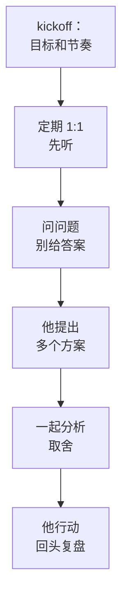

## Q
**Mentoring · 提问多于给答案**｜原则 · 必会

一位工作一年的同事每次卡住都来找你，你每次都直接告诉他怎么改，三个月后他还是什么都来问。你该怎么调整指导方式？

## A
**原则：** 好的 mentor 不是替人解决问题，而是**帮他长出自己解决问题的能力**。尽量晚给答案：多问、给备选、让他自己选。

**怎么做：**
1. **开头先对齐：** 各自想得到什么、聊什么主题、多久聊一次（常见是两周一次，30–60 分钟）、两次之间能否随时问、下个月想先进步的一个点、怎么评估效果。
2. **先听：** 用"你在忙什么""卡在哪里""这周目标是什么"开场，听出你能帮的地方。
3. **不直接端出答案：** 问他试过什么，提出备选，忍住不说"你应该这样做"。
4. **帮他想出多个方案并说清取舍：** 讲概念比给方案更有用，答案很少是非此即彼。
5. **区分话题：** 技术问题可以用提问引导；沟通、冲突类问题，倾听最重要。
6. **提供背景和视角、引荐人脉：** 讲你当年怎么挣扎过，让他少焦虑；把他介绍给能帮忙的人。
7. **站在他这边：** 一句"你可以的"很有力量。你也该想从他身上学到点什么。

**常见错法：**
- **永远直接给答案：** 对方学不会独立。
- **没有约定：** 想起来才聊，没有目标，也没有节奏。
- **只谈技术：** 不理会他的情绪和处境。
- **勉强当 mentor：** 没时间或不擅长这块，可以说不，并推荐别人。

**回到题目：** 下次他来问，先反问："你试过什么？你觉得有哪几种做法？"让他讲取舍，你补充遗漏的点。定一个下个月的小目标（比如独立写完一份设计文档），每两周回顾一次。

**面试官在考什么：** 你是否在放大别人，而不是自己成为瓶颈。

**适合配哪类故事：** 你带一位同事成长到能独立负责一块工作，你从答题人变成教练的经历。

**出处：** Orosz《The Software Engineer's Guidebook》ch12 §3 "Mentoring"（Kicking off mentoring；When you're the mentor：Avoid serving up answers on a silver platter；Help mentees come up with multiple solutions）
