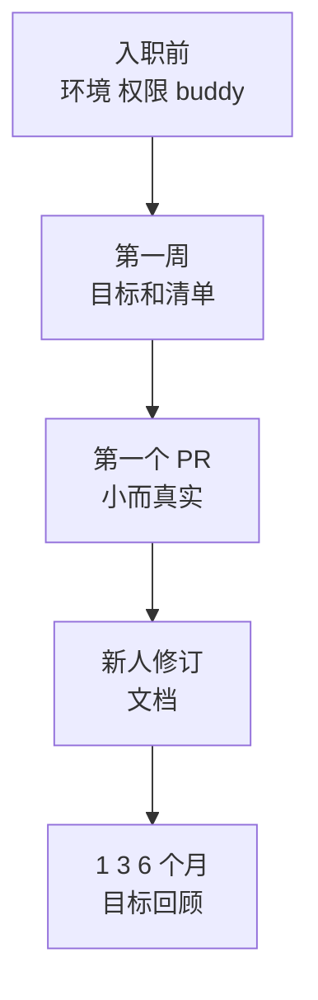

## Q
**Onboarding · 让新人尽快上手**｜原则 · 必会

下周有一位新工程师加入你们的后端团队。上次新人花了六周才发出第一个 PR，说"文档都过期了"。你负责他的 onboarding，怎么安排？

## A
**原则：** 新人越快上手，加入对项目和团队的帮助越早。把**隐性知识写成文档**，并让新人用第一个任务检验并修正这份文档。

**onboarding 文档应包含：**
| 内容 |
|---|
| 系统概览：职责，和哪些系统交互 |
| 如何修改：拉代码、改代码 |
| 如何测试和验证改动 |
| 如何部署到生产 |
| 如何监控、告警如何工作 |
| 事故时的调试技巧 |

**怎么做：**
1. 指定一位 onboarding buddy，是可以随时被打断来回答问题的人。
2. 第一周清单：账号和环境、读概览文档、认识相关团队；和他明确第一个月、前三个月、前六个月的目标。
3. 第一个 PR：小而真实，尽快上线。小公司可以第一周就发布东西。
4. 让新人记一份"备忘单"（缩写、构建命令、重要链接），并在 onboarding 结束前更新文档里的错误和缺失；这样每一轮新人都在改进文档。
5. 团队手册：工作怎么排优先级、团队如何运作。
6. 提醒新人许多事一开始会让人困惑，这是正常的。

**常见错法：**
- **文档没人维护：** 没有新人时没有写的动力，下次又过期。
- **没有 buddy：** 新人不好意思问，卡很久。
- **第一个任务太大：** 迟迟看不到成果，信心受挫。
- **假设新人什么都知道：** 隐性知识没写出来。

**回到题目：** 在他入职前先把环境、权限、文档过一遍；指定 buddy；第一周只设一个小目标（修一个小 bug 并上线）；让他边做边修订文档，并作为本次 onboarding 的最后一项任务交回。

面试官看什么 · 配哪类故事 · 出处

**面试官在考什么：** 你是否有系统地帮新人成长的意识，并把知识沉淀为团队资产。

**适合配哪类故事：** 你改进了团队的 onboarding（文档、buddy、第一个任务），明显缩短了新人上手时间的经历。

**出处：** Orosz《The Software Engineer's Guidebook》ch13 §4 "Documentation"（Onboarding documentation：七项内容，让新人修订文档）；ch6 §6 "Onboarding to a New Job"（onboarding buddy、cheat sheet、ship in week one at small companies）

