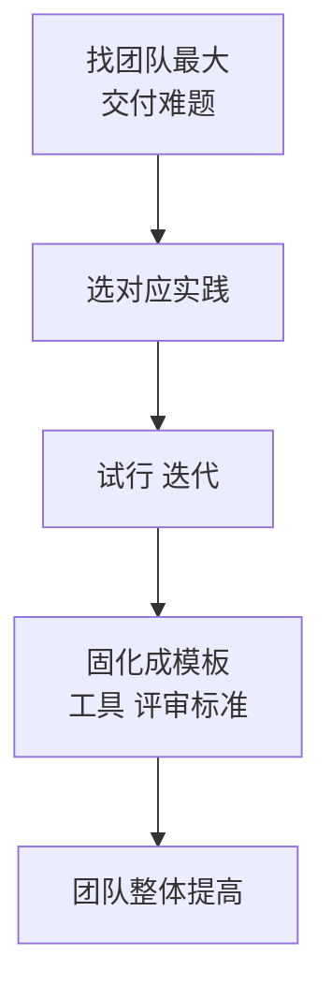

## Q
**Raising the bar · 用模板和工具抬高整体水平**｜原则 · 加分

你的代码质量不错，但团队里每个人的做法不同：有的写设计文档，有的不写；有的写测试，有的不写。你如何让整个团队的水平提高，而不是你一个人把关？

## A
**原则：** 资深工程师抬高标准靠**可复制的做法**：模板、工具、评审标准，而不是亲自把每个关。先问"团队交付的最大难题是什么"，再选相应的实践，不是照搬"最佳实践"。

**怎么做：**
1. **别叫"最佳实践"，叫 engineering practices：** 同一做法对不同团队效果不同。
2. **从问题出发：** bug 多？考虑 TDD、测试环境、生产测试；评审太慢？专门留时间、少评审、更小的改动。
3. **常见实践清单：** 书面规划流程（RFC、design doc、ADR）、自动化测试、TDD、代码评审、post-commit 评审（更快，但回归更多，适合很小或高度资深的团队）、测试环境、分阶段发布、安全地在生产测。
4. **固化：** 把做法写成模板（设计文档、ADR）、脚手架、linter 和评审清单，让"对的做法"最容易；在团队里记录 "done" 的定义和代码风格。
5. **先试再推：** 亲自试，听有第一手经验的人的意见；先在小范围验证。
6. **用身教：** 自己先用，代码评审里体现标准。
7. **不要成为瓶颈：** 标准写下来，别靠你一个人守。

**常见错法：**
- **照搬大公司流程：** 不适合你的团队。
- **只靠口头：** 新人不知道标准。
- **强推：** 没有考虑摩擦，对方只是装作遵守。

**回到题目：** 选一个最痛的问题（例如线上 bug）；试行一项实践（PR 模板里加测试清单）；见效后写进团队文档，并在评审里一致执行。

面试官看什么 · 配哪类故事 · 出处

**面试官在考什么：** 你是否能系统地提升团队，而不是个人英雄主义。

**适合配哪类故事：** 你引入模板、检查清单或自动化，使团队的质量或速度可见提升的经历。

**出处：** Orosz《The Software Engineer's Guidebook》ch13 §5 "Scaling Best Practices Across the Team"；ch23 §2 "Helpful Engineering Processes"（Define "done"、Coding style guidelines）

