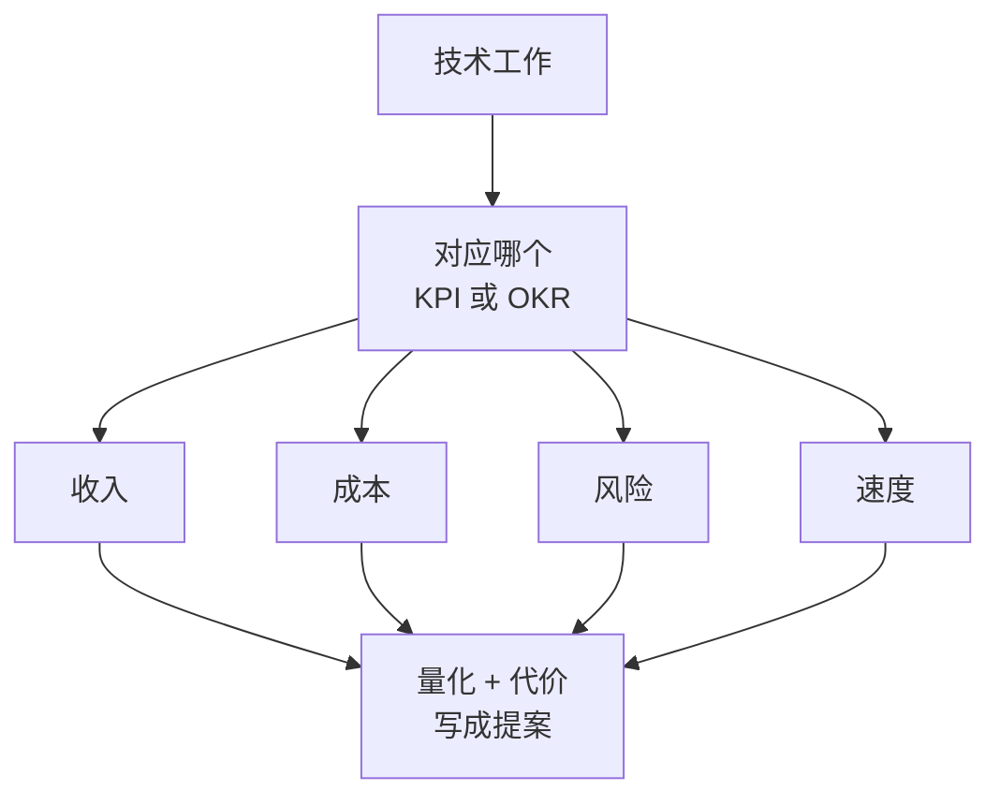

## Q
**Business value framing · 用业务语言讲技术**｜原则 · 必会

你想花一个季度把订单服务里的旧支付模块重写，理由是"代码很烂、测试覆盖低"。产品和经理听了没反应。你怎么重新表述，才能争取到时间？

## A
**原则：** 工程师拿工资是**为业务解决问题**，写代码只是常见手段。要争取资源，就把技术工作翻译成业务关心的几个量：**收入、成本、风险、速度**，并对应到团队的 KPI 或 OKR。

| 角度 | 例子的说法 |
|---|---|
| 收入 | 旧模块不支持新渠道，每月流失的订单量 |
| 成本 | 每次改动要多花多少工程日；基础设施成本 |
| 风险 | 去年的相关故障，对可用性 KPI 的影响 |
| 速度 | 新增一个渠道从几周变成几天 |

**怎么做：**
1. 弄清团队和公司的目标：North Star（愿景）、KPI（可量化的进度指标，如收入、客户数、流失率、可用时间）、OKR（一个定性目标 + 若干可量化的关键结果）。
2. 把你的工作对应到具体的关键结果，例如"提升可靠性：可用时间 99.8% → 99.9%"。
3. 用数据说话：多少收入、多少成本、多少故障、多少工时。
4. 搞清楚你的产品对业务的价值：直接创造收入，还是必要的成本项；它对用户增长和留存的贡献。
5. 提出清楚的代价与替代：做多久，不做会怎样，能否分阶段。

**常见错法：**
- **用技术词汇做理由：** "代码很烂"对业务没有意义。
- **没有数字：** 说不出影响多大。
- **不知道业务怎么赚钱：** 对不上他们关心的 KPI。
- **KPI 能被糊弄：** 好的 KPI 可衡量、不含糊、难以在没有真实改进的情况下做出好看数字。

**回到题目：** "旧支付模块导致最近三个月 X 起故障，影响可用时间 KPI；每新增一个支付渠道要多花 Y 周，已经因此推迟了 Z 项业务。重写用一个季度，分两阶段，第一阶段先迁移最频繁出故障的部分。"

面试官看什么 · 配哪类故事 · 出处

**面试官在考什么：** 你能否站在业务角度讲技术价值，并和 EM、PM 用同一种语言。

**适合配哪类故事：** 你把一项技术工作用数据翻译成业务收益，成功争取到资源并最终兑现的经历。

**出处：** Orosz《The Software Engineer's Guidebook》ch21 §1 "Northstars, KPIs, OKRs"；ch21 §2 "Understand the product's business value"；ch11 §4（"we are not paid to write code … solve problems for the business"）

