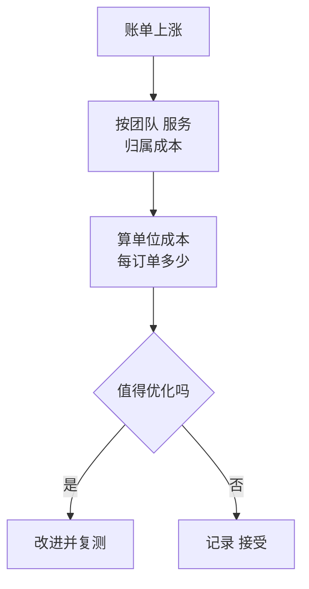

## Q
**Cloud cost awareness · 成本要有归属**｜原则 · 必会

月底云账单比上月涨了四成，财务来问原因，没有一个团队说得清是谁用的。你怎么理解并推动改善？

## A
**原则：** 云成本不只是"省钱"，而是**让每个团队知道自己用了多少、换来了什么价值**，再据此在速度、成本、质量之间取舍。要有**归属（谁用的）**和**单位成本（每个订单、每个用户花多少）**，才能判断优化是否值得。

**怎么做：**
1. **归属：** 给资源打标签、按团队和服务拆分账单，让每个团队看到自己的成本。
2. **单位成本（unit economics）：** 把总成本除以业务量，例如每个订单、每个活跃用户的成本。总成本涨了不一定是坏事：业务也在涨时，要看单位成本有没有变差。
3. **判断值不值得优化：** 比较省下的成本与投入的工程时间，以及对速度和质量的影响；对高频、大规模的部分才值得。
4. **工程和财务协作：** 工程、财务、产品一起讨论，在速度、成本、质量之间取舍。
5. **把成本写进目标：** 如 OKR 里的"提高虚拟机 CPU 中位利用率"这类关键结果。

**常见错法：**
- **只看总额：** 业务增长带来的增加被当成浪费。
- **没有归属：** 没人负责，也没人优化。
- **为省钱牺牲可靠性：** 省下的钱不够补一次事故。
- **过早优化：** 为小额成本投入大量工程。

**回到题目：** 先按服务和团队拆账单，找出涨幅最大的前几项；再除以订单量，看单位成本是上升还是下降。如果是某一类任务的利用率很低，把它列成有明确节省和工时的优化项目；如果单位成本稳定，涨幅主要来自业务增长，就向财务解释。

面试官看什么 · 配哪类故事 · 出处

**面试官在考什么：** 你有没有成本意识，并能把它放进工程决策中。

**适合配哪类故事：** 你找出云成本的主要来源，用归属和单位成本做出了有数据支撑的优化的经历。

**出处：** FinOps Foundation《What is FinOps?》（finops.org/introduction/what-is-finops/：工程、财务、业务协作；在速度、成本、质量之间取舍；目标是获得最大价值，而不只是省钱）；Orosz《The Software Engineer's Guidebook》ch21 §1（OKR 示例 "Optimize our infrastructure costs"）

