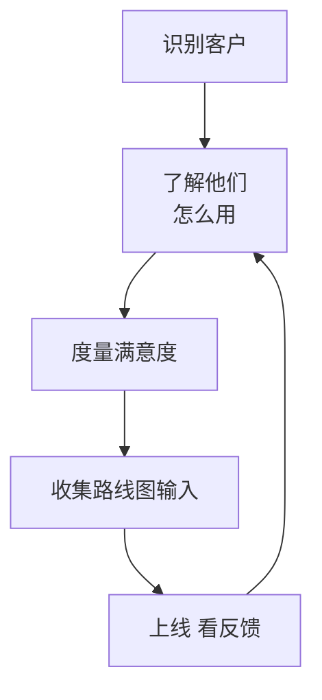

## Q
**Customer feedback loop · 离客户近一点**｜原则 · 加分

你们团队做的是内部平台，没有产品经理。路线图靠工程师自己想，上线后很少听到使用者的声音。你怎么建立客户反馈循环？

## A
**原则：** 理解客户怎么用产品，是**发现值得解决的问题**的最直接办法（Orosz 说 senior 解决问题，staff+ 还要找问题）。没有 PM 时，由你**戴上产品经理的帽子**。

**怎么做：**
1. **识别并理解客户：** 谁是客户、他们的问题是什么；用 customer persona 帮工程师共情。
2. **度量满意度：** 平台团队常没有这一步，因为不做调查，也不找客户团队聊；做起来。
3. **让客户参与路线图：** 内部平台更没理由不问其他团队的意见，需要有人亲自去对接。
4. **站在客户的位置：** 自己用产品（B2C 就注册使用；B2B 像 Shopify 的开发者一样自己开店体验；内部客户用测试账户）。
5. **和客服靠近：** 读工单、听电话，或和客服聊最常见的问题和满意度趋势。
6. **知道客户为什么用：** 和客户聊；旁听用户研究；读评价；了解竞品并做对比文档（用户流程、功能、策略、用户反馈）。
7. **上线后继续看：** 看反馈渠道、支持工单和指标，再回到第 1 步。
8. **把洞察带到桌面上：** 带着有依据的产品建议，提供产品与工程取舍。

**常见错法：**
- **只听内部想法：** 容易做偏。
- **只做一次调研：** 要持续循环。
- **反馈不转化为行动：** 对方不再愿意给。

**回到题目：** 两周内和三个主要使用团队各聊一次；做一份简短满意度问卷；把客服/支持渠道里关于平台的问题汇总；用这些输入排下一个季度的路线图，并回访使用者。

**面试官在考什么：** 你是否主动找问题、对客户价值负责。

**适合配哪类故事：** 你通过接近客户（用户访谈、客服工单），发现并解决了一个团队原本没注意的问题的经历。

**出处：** Orosz《The Software Engineer's Guidebook》ch21 §2 "Your Team and Product"（Put on a product manager hat、Put yourself in the customer's shoes、Get involved with customer support、Know why customers use your product）；ch5 §1 "Product Teams and Product-Minded Engineers"
