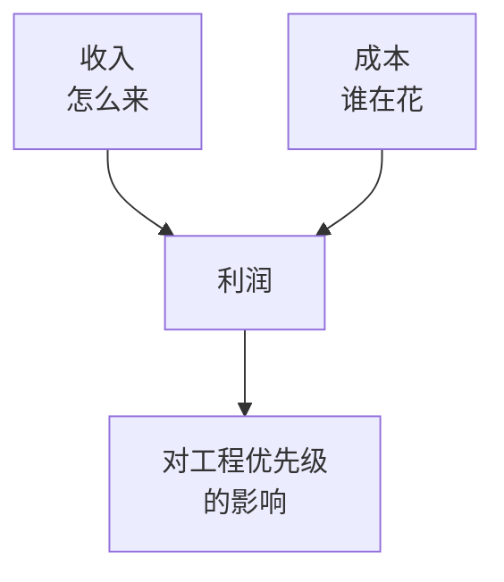

## Q
**How the company makes money · 公司怎么赚钱**｜原则 · 加分

面试官问："你们公司怎么赚钱？这对你们工程团队的优先级有什么影响？"你只知道产品的功能，答不上来。资深工程师该怎么了解？

## A
**原则：** 工程师不是为了写代码拿工资，而是**为业务解决问题**。理解收入模型、利润和成本，才能判断什么值得做。要主动去了解，而不是等人讲。

**怎么做：**
1. **问基本问题：** 公司怎么赚钱，怎么把收入变成利润，怎么管理成本？还没盈利的话，路线是什么？
2. **unit economics（单位经济）：** 卖出一个单位的产品或服务的成本，例如 Uber 早期在新城市，一次行程的单位成本可能是收入的两倍。
3. **知道 KPI：** GMV、收入、客户数、DAU/MAU、churn、uptime、支持工单比例、NPS、CLV、CAC 等。举例：Uber 收入约占 GMV 的 10–20%，Stripe 或 Adyen 这类支付公司的收入占 GMV 约 1–3%。这类数字随公司而变，用时对照最新资料。
4. **上市公司：** 看季度财报和 earnings call：收入趋势、盈利、重点投资方向、分析师的提问、对未来的承诺。理解 debit/credit、net revenue、cash flow、EBITDA 等术语。
5. **创业公司：** 内部更透明，主动要业务指标，和创始人聊他们对业务和投资者的想法。
6. **多聊：** 和产品、业务、销售、客服做一对一；读 PRD；参加跨职能项目。
7. **转化为工程判断：** 业务靠规模还是靠高毛利？故障损失的是收入还是信任？成本压力下平台开支怎么分摊？

**常见错法：**
- **只懂自己的模块：** 无法解释它的商业价值。
- **只看收入不看成本。**
- **把时效性数字当常识。**

**回到题目：** 先补功课：读上一季度的财报或内部业务评审，和 PM 聊产品的收入贡献；然后回答："我们靠 X 收费，主要成本是 Y，所以团队今年的重点是提高 Z 的可靠性/降低单位成本。"

**面试官在考什么：** 你的业务意识，能否把工程选择和公司目标联系。

**适合配哪类故事：** 你因为理解了公司的收入或成本结构，改变了一个工程优先级或方案的经历。

**出处：** Orosz《The Software Engineer's Guidebook》ch21 §3 "Your Company"（What is the business model?）、§4 "Public Companies"、§5 "Startups"、§1（KPI 列表与 GMV/收入比例）；ch11 §4（"We are not paid to write code"）
