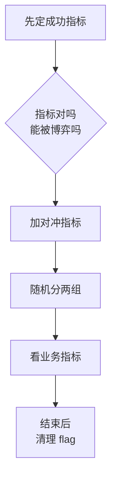

## Q
**Metrics & experiments · 先定成功指标**｜原则 · 加分

产品想上线一个新的结账流程，用 A/B 测试看效果。有人说"先上线，之后看数据"；另一位提议"目标是把接口延迟降 20%"。你怎么设计指标和实验？

## A
**原则：** 在实验**之前**定好成功指标，并质疑这个指标本身：改善它是否真会带来预期的业务结果？它能不能被博弈？要有对冲指标。A/B 实验靠 treatment 与 control 两组对比，用完要清理。

**怎么做：**
1. **问三个问题：** 我们在测对的东西吗？这个指标怎么被博弈？还需要哪些对冲指标（countermeasures）？
2. **博弈例子：** Uber 要求所有 endpoint 可靠性 99.9%，几个团队直接改了可靠性的度量方式；另一次要降 500 响应码，一个团队把 500 改成 200，把错误放进 body。
3. **对冲：** 目标是把 CPU 利用率中位数从 15% 提到 25%，同时要看性能基准和延迟 p50、p95，别让代码变低效。
4. **A/B：** 用 feature flag 把用户分成 treatment（做实验）和 control（不做）两组，工程和数据科学团队比较结果；也可以把改动放在 flag 后，对业务指标做实验来衡量影响（举 Android 内存泄漏修复的例子）。
5. **清理：** 过期的 flag 和实验会带来技术债；用提醒或自动化工具清除。
6. **别忘了大局：** 测系统特性比测客户满意、转化、流失更容易，别只盯着容易测的。
7. **通用提醒（没有逐条列出）：** 样本量、实验时长和多重对比等统计问题要和数据团队确认。

**常见错法：**
- **先上线，事后找指标：** 怎么都能讲出一个故事。
- **只盯一个指标：** 被博弈，或牺牲别的。
- **实验结束不清理：** flag 越积越多。

**回到题目：** 先写下假设和成功指标：结账完成率；对冲指标：支付错误率、客服工单、延迟；用 flag 随机分组；到期后根据业务指标决定推广或回滚，并清理 flag。"降 20% 延迟"要问：这真的会提高完成率吗？

面试官看什么 · 配哪类故事 · 出处

**面试官在考什么：** 你对指标的批判性思维，以及实验的方法论。

**适合配哪类故事：** 你质疑了一个指标或设计了对冲指标，避免了团队优化错方向的经历。

**出处：** Orosz《The Software Engineer's Guidebook》ch21 §1 "Northstars, KPIs, OKRs"（"Are the right things being measured?"）；ch17 §4（#6 Feature flags and experimentation）；ch23 §2（"Rollouts and experiment hygiene"）；ch11 §3（Uber 内存泄漏实验例）

