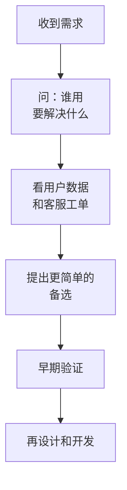

## Q
**Problem before solution · 先验证需求**｜原则 · 必会

产品经理发来一份需求："给运营后台加一个导出所有订单到 Excel 的按钮。"你们团队已经排了两周来做。你怎么做，才不会交付一个没人用的功能？

## A
**原则：** 先搞清楚**客户真正的问题**，验证它值得解决，再设计方案。需求里的"做什么"常常是对问题的一个猜测。

**怎么做：**
1. **问为什么：** 谁在用、遇到什么问题、现在怎么绕过。不要只实现需求文档。
2. **站在客户的位置：** 自己用产品；看客服工单、听客服电话，或者和客服聊最常见的问题。
3. **理解产品的业务价值：** 它对收入、成本、留存的贡献是什么？
4. **提出替代方案和取舍：** 有时导出按钮不用做，只需把常用报表直接放进后台；或者先做最小的一版。
5. **尽早验证：** 在功能上线前找人试用，例如同事试用、给 PM 演示、团队集中试错，问"用户会按我们想的方式使用吗"。
6. **上线后看用户行为和业务数据**，才算做完。

**常见错法：**
- **照单实现：** 做出了功能，没有解决问题。
- **不接触用户：** 只在代码里猜用户想要什么。
- **边缘情况处理过度：** 评估边缘情况的影响与代价，选真正需要处理的。
- **上线就算结束：** 没看是否有人用。

**回到题目：** 先找运营同学问：为什么要导出？导出后做什么？也许他们只是想每天看某个对账表。看一遍客服工单，确认需求频率；若真的是对账，做一个对账报表比导出更省事；先做最小一版，给两位运营试用。

面试官看什么 · 配哪类故事 · 出处

**面试官在考什么：** 你是否有产品意识，而不是只做"接单的工程师"。

**适合配哪类故事：** 你追问需求背后的问题，用更简单或不同的方案解决了真实问题，或者阻止了一个没人用的功能的经历。

**出处：** Orosz《The Software Engineer's Guidebook》ch21 §2 "Your Team and Product"（Put yourself in the customer's shoes；Know why customers use your product）；ch5 §1 "Product Teams and Product-Minded Engineers"（Quick product validation cycles；End-to-end product feature ownership）

