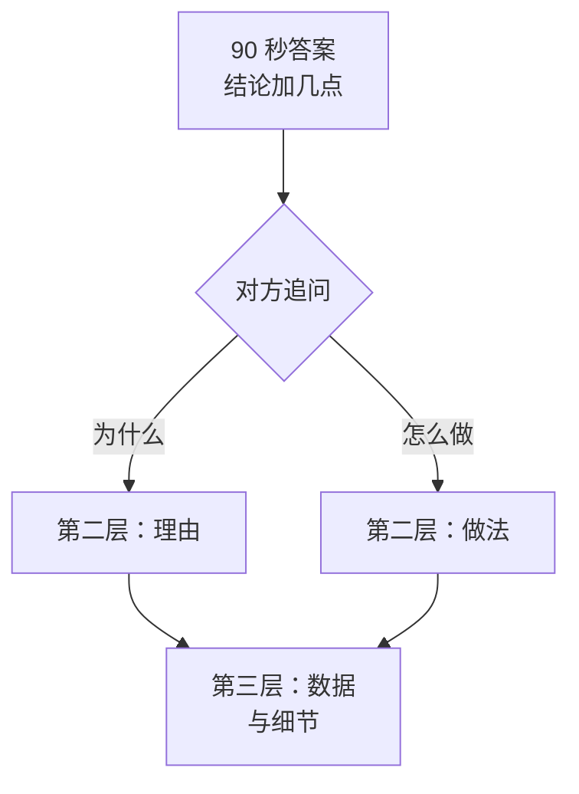

## Q
**90 seconds, then layers · 先短答再下潜**｜原则 · 追问

面试官问了一个开放问题："Tell me about the caching design." 你有三十分钟的素材。该一次讲完，还是怎么讲？

## A
**原则：** 先用约九十秒给**完整但粗**的答案（结论加两三个理由），然后停下，让对方的追问决定往哪一层下潜。每一层的陈述都会引起下一层的问题，对方的追问就是在选路径。

**怎么做：**
1. 第一层只放结论和两三个要点，不放细节。
2. 说完停一下，或问 "Which part would you like me to go into?"
3. 对方追问哪里，就只深入那里；回答仍然先给结论。
4. 时间不够时在任何一层停下，仍然是一个完整的答案。

**常见错法：**
- **一口气讲到底：** 对方想问的点被淹没。
- **只有短答案没有后续：** 被追问时没有准备。
- **每层都从头重述：** 浪费时间。

**示例：** "We cache at two levels, an in-process cache for hot keys and Redis for the rest, because reads are 95 percent of traffic. Want me to go into invalidation or sizing?"

**出处：** Minto p. 33–40（Ch.2 The Vertical Relationship：每一层陈述引出下一层的问题）（部分）；90 秒的长度是练习用的经验值，非引用
