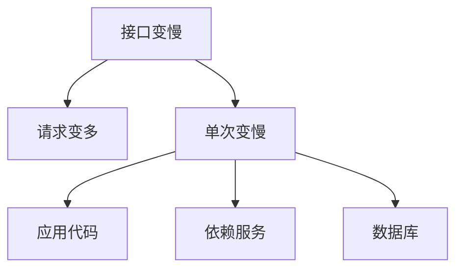

## Q
**Logic trees & issue analysis · 结构化排查**｜原则 · 追问

线上接口突然变慢。你要排查原因，又要向别人讲清你排查了什么、排除了什么。怎么结构化？

## A
**原则：** 先画一棵**逻辑树**：把可能的原因拆成 **MECE**（mutually exclusive, collectively exhaustive：互不重叠、合起来没有遗漏）的几类，再逐层往下，按"最容易排除"的顺序检查。Minto 称这是诊断框架：先想象问题可能出在哪些部位，再决定分析哪里。

**怎么做：**
1. 第一层用一个能覆盖全体的标准拆开（"请求变多" vs "单次变慢"）。
2. 每一层检查：互不重叠吗？合起来有遗漏吗？
3. 按最容易排除的先查，而不是最可能的先查。
4. 讲述时按树走：先说你怎么分类，再说哪几类被排除了，剩下哪类。
5. 同样的树可用来想方案："怎么降成本"也可以拆成互不重叠的几条路。

**常见错法：**
- **想到哪查哪：** 无法向别人说明你查了什么。
- **分类互相重叠：** 同一原因出现在两个分支里。
- **漏掉"其他"：** 树没有闭合。

**出处：** Minto p. 161–192（Ch.9 Logic in Problem Analysis：Devising Diagnostic Frameworks；Developing Logic Trees）
