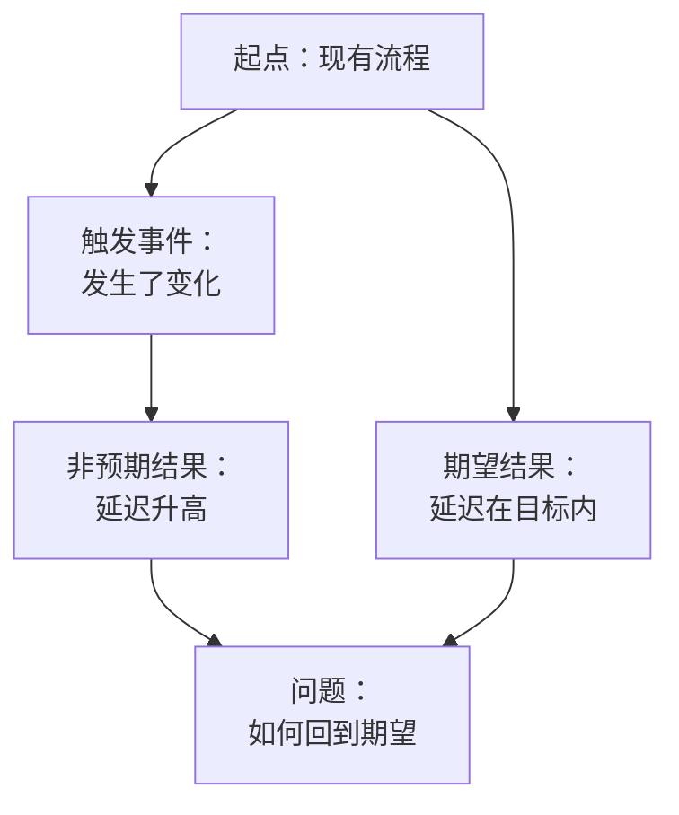

## Q
**Problem definition framework · 定义问题**｜原则 · 追问

结算服务上周延迟升高，大家各自提了十个方案。你想在讨论方案前先把问题说清楚。该写下哪几项？

## A
**原则：** 问题是"你**想要的**和你**现在有的**之间的差距"。差距不是凭空出现的，它从一个已有的情境中产生，所以问题的定义要包含这个情境的来历：

**怎么做：**
1. **起点：** 现在的结构或流程，讲清它本来是怎么工作的。
2. **期望结果：** 它应该带来什么。
3. **触发事件：** 发生了什么，让你发现不对。
4. **非预期结果：** 现在实际是什么。
5. **问题：** 非预期结果和期望结果之间的差距，写成一个问题。
6. 这四项也是 SCQA 的素材：起点是 Situation，触发事件和非预期结果是 Complication，问题是 Question。

**常见错法：**
- **直接跳到方案：** 十个方案解决的是十个不同的问题。
- **把现象当问题：** "延迟高"不是问题，没有说明高到什么程度算差距。
- **没有期望结果：** 没人知道做到什么算解决。

**出处：** Minto p. 137–160（Ch.8 Logic in Problem Solving：The Problem-Definition Framework）
