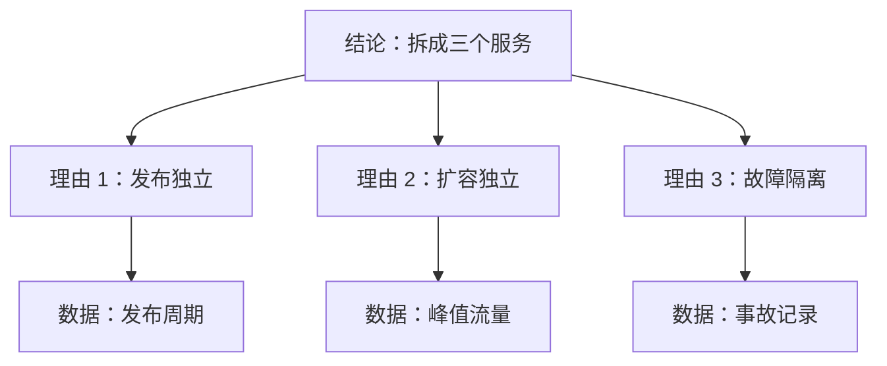

## Q
**Pyramid principle · 结构**｜原则 · 必会

你要在 design review 上推荐"把单体拆成三个服务"。你手上有十来条理由和数据，怎么组织才不会讲成流水账？

## A
**原则：** 每个想法只出现在一层里：顶上是**一个结论**；它下面是回答"为什么 / 怎么做"的一组要点；每个要点下面再放证据。上一层永远是下一层的**概括**。

**怎么做：**
1. 先写顶层一句话，它必须是读者"不知道、想知道"的东西。
2. 想象读者追问 Why / How，下一层只回答这个问题。
3. 同一层的要点要是同类的（都是"理由"，或都是"步骤"）。
4. 读者没有新问题了，就停。

**常见错法：**
- **同层混类：** 一条是理由，一条是风险，一条是排期，放在一起读者看不出逻辑。
- **证据直接挂在结论下：** 十条数据摊开，听的人自己分组。
- **提前回答没人问的问题：** 还没说结论，先讲"我们的假设"。

**改写示例：**
- Before: "Release takes two hours, the billing team keeps blocking us, last quarter we had two outages, traffic doubles on Fridays…"
- After: "I recommend splitting into three services, for three reasons: independent releases, independent scaling, and fault isolation. Let me give one data point for each."

**出处：** Minto p. 17–32（Ch.1 Why a Pyramid Structure）；p. 33–40（Ch.2 The Vertical Relationship / The Horizontal Relationship）
