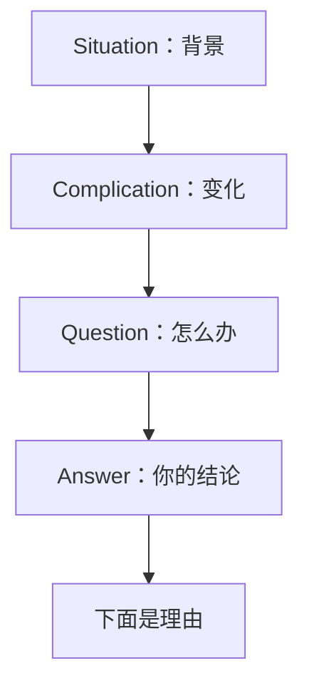

## Q
**SCQA · 开场框架**｜原则 · 必会

你要向另一个团队的 tech lead 汇报"支付重试逻辑要重写"。他对背景只知道一半，开头该怎么讲，才不会又长又散？

## A
**原则：** 开场用四步讲一个小故事：**Situation**（双方都认同的背景）→ **Complication**（出了什么变化）→ **Question**（因此读者心里冒出的问题）→ **Answer**（你的结论）。目的是让你和听的人"站在同一个地方"，再开始讲结论。

**怎么做：**
1. Situation 只写对方无争议、已经知道的事（时间、地点、对象）。
2. Complication 写打破平静的那件事：故障、需求变化、数据。
3. Question 常常可以不说出口，让听的人自己问出来；说的话也只一句。
4. Answer 就是你的首句结论（回到 answer first）。

**常见错法：**
- **Situation 写成大段历史：** 对方早知道的东西，一句话带过。
- **没有 Complication：** 听的人不知道为什么今天要谈这件事。
- **Answer 回答的不是那个 Question：** 读者问"怎么办"，你却在讲"为什么出问题"。

**改写示例：**
- "Our payment service retries failed charges (S). Last month a retry storm doubled the load on the bank gateway (C). So how do we retry safely (Q)? I propose capped exponential backoff with a per-merchant budget (A)."

出处

Minto p. 33–48（Ch.2 The Introductory Flow）；p. 57–64（Ch.4 Fine Points of Introductions：The Story Form）

