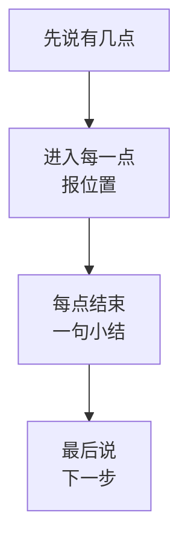

## Q
**Signposting · 路标**｜原则 · 必会

你要用五分钟讲清一个迁移方案。听到第三分钟，经理问："所以你现在讲到哪了？"该怎么避免这种情况？

## A
**原则：** Signposting 就是给听的人**路标**：先告诉他一共几块、各是什么，每进入一块再报一次位置，结束时说一句收尾。听的人总能知道"我在哪、还剩什么"。书面文档里同样做：要点放文首，用标题和过渡句标出结构。

**怎么做：**
1. 开头：一句话结论加块数："I'll cover three things: scope, risks, and timeline."
2. 转场：说出下一块的名字："Now the risks."
3. 收尾：点出结论和下一步："So the ask is two engineers for one quarter."
4. 书面：开头用一段话说明全文要点，各节标题用完整的短句。

**常见错法：**
- **报了三点却讲了四点：** 听的人开始怀疑自己漏听。
- **转场靠停顿：** 听的人分不清是在换话题还是在补充。
- **路标太多：** 两分钟的话不需要每三十秒报一次位置。

**改写示例：**
- Before: "…and also the old cron jobs are a problem. And then there's the data. Oh, and we need approval."
- After: "That covers risk one, the cron jobs. Risk two is the data migration. And finally, what I need from you: approval to start in March."

**出处：** Minto p. 185–208（Ch.10 Reflecting the Pyramid on the Face of the Page：Show Transitions Between Groups、Stating Next Steps）；Google Technical Writing One《Documents》（要点放文首）
