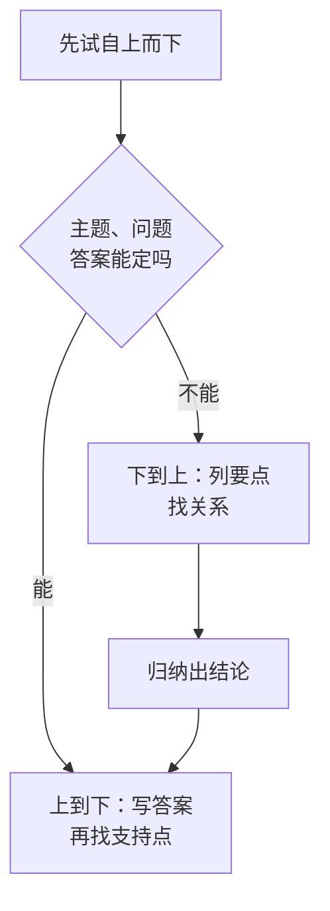

## Q
**Top-down vs bottom-up · 怎么搭**｜原则 · 追问

你要写一份方案总结，素材一大堆，但"我到底要说什么"还很模糊。该从结论开始想，还是从素材开始整理？

## A
**原则：** 能先想清楚结论就**自上而下**（先确定主题、读者的问题、你的回答，再往下找支持）；想不清楚才**自下而上**（先列出所有想说的点，找关系，归纳结论）。自上而下通常更容易，先试它。

**怎么做：**
1. **自上而下：** 写出主题 → 读者的问题 → 你的答案 → 背景与变化（Situation 和 Complication，见 SCQA）→ 下一层要点（Key Line：顶点下面第一层要点）。
2. **自下而上：** ① 列出想说的所有点；② 弄清它们之间的关系，分组、排序；③ 得出每组的结论，再得出总结论。
3. 无论哪种，最后都检查：每层是不是下一层的概括。

**常见错法：**
- **一上来就写全文：** 写到一半才发现没有结论。
- **只列要点不归纳：** 一堆事实没有结论。
- **硬凑上层：** 归纳不出来时说明要点本身不成组。

出处

Minto p. 41–56（Ch.3 How to Build a Pyramid Structure：The Top-Down Approach / The Bottom-Up Approach）

