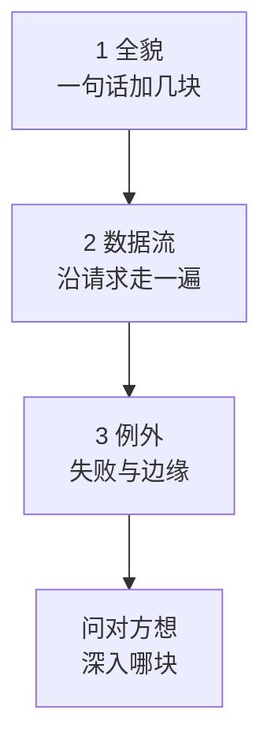

## Q
**Narrating a diagram · 三步讲图**｜原则 · 必会

白板上已经画好一张有七八个框的架构图：客户端、网关、订单服务、库存服务、数据库、消息队列、通知服务。面试官说："Walk me through it." 你从哪里开口？

## A
**原则：** 讲图的顺序是**全貌 → 数据流 → 例外**。先一句话说这张图解决什么、分几块；再沿着一个请求从入口走到出口；最后才讲失败、重试、边缘情况。不要按"你画的先后"或"左上到右下"逐个框念名字。

**怎么做：**
1. 全貌：一句话。"This is an order system with three parts: an API layer, two services, and an async notification path."
2. 数据流：用一个具体请求，沿箭头讲，每经过一个框说它做了什么。
3. 例外：说"现在讲失败的情况"，再讲 retry、超时、降级。
4. 收尾：把选择权交给对方："Where would you like me to go deeper?"

**常见错法：**
- **逐框念名字：** "这是网关，这是服务 A…"，听的人得不到任何关系。
- **一上来就讲例外：** 主路径还没建立，例外无处安放。
- **箭头不说方向和内容：** 听的人不知道流动的是请求、事件还是数据。

**改写示例：**
- Before: "So this is the gateway, and this is the order service, and this is the database, and this one is the queue…"
- After: "In short, a request comes in through the gateway, the order service writes it to the database, and an event goes to the queue so notifications don't block the user. Let me trace one order."

出处

Minto p. 97–112（Ch.6 Imposing Logical Order：Structural Order，描述一个结构）；p. 209–224（Ch.11 Designing Exhibit Slides，部分）

