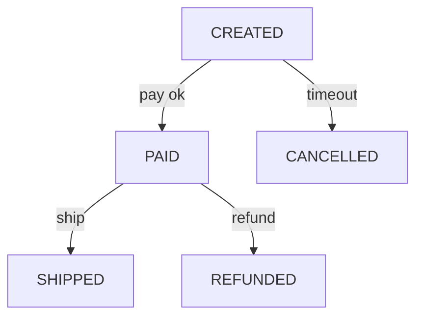

## Q
**Sequence & state diagrams · 时序图与状态图**｜原则 · 追问

你要说明"用户支付时，订单服务、支付服务、银行三者怎么交互"，以及"订单有哪些状态、怎么转换"。这两件事分别该用什么图？

## A
**原则：** 按你要说的内容选图：
- **Sequence diagram（时序图）：** 说**多个参与方按时间先后怎么交换消息**。每个参与方一条竖线（lifeline），消息是它们之间的横向箭头，从上到下就是时间顺序。
- **State diagram（状态图）：** 说**一个东西有哪些状态，在什么事件下从一个状态转到另一个**。

**怎么做：**
1. 时序图：先列参与方（不超过五六个），再按时间从上到下画消息，同步调用和异步消息用不同箭头，返回用虚线。
2. 状态图：先列状态，再画转换，每个箭头标**触发事件**。
3. 讲述时沿着时间或状态走一遍，像讲一个具体例子。
4. 用一句话说它要说明的要点。

**常见错法：**
- **用架构图表达时间顺序：** 箭头的先后看不出来。
- **状态图漏掉失败和超时的转换。**
- **时序图的参与方过多。**

出处

UML 时序图通用规则（uml-diagrams.org/sequence-diagrams.html，术语为 UML 标准用法）；做法由规则推导

