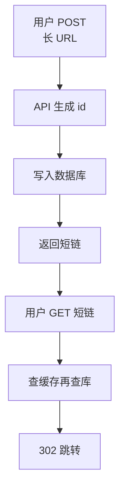

## Q
**Walk a concrete example · 一个请求走到底**｜原则 · 必会

你画完了一个短链接服务的架构图，面试官问："这样真能工作吗？" 你该怎么证明？

## A
**原则：** 用**一个具体的请求**，带真实的值，从头走到尾，每一步说出"哪个组件、做了什么、状态怎么变"。抽象图只说明组件存在，具体例子才证明它们连得起来。

**怎么做：**
1. 选一个最典型的例子，给它具体的值：`POST /v1/urls {"url": "https://example.com/a/very/long/path"}`。
2. 沿图中的箭头，一步一步说出数据怎么变："the service generates the id `aZ3k9`, stores the mapping, returns `short.ly/aZ3k9`."
3. 再走一次读路径，说明缓存命中和未命中的区别。
4. 走的时候发现图上缺东西，当场补上，并说出来："I just noticed I forgot X."

**常见错法：**
- **只讲组件职责不讲流转：** 对方看不到数据怎么走。
- **例子太复杂：** 一次塞进所有边缘情况，主路径反而看不清。
- **只走成功路径：** 简短地走一次失败路径，会更有说服力。

出处

hellointerview.com/learn/system-design/in-a-hurry/delivery（start from the API contract, trace each through the design；keep the initial design simple）

