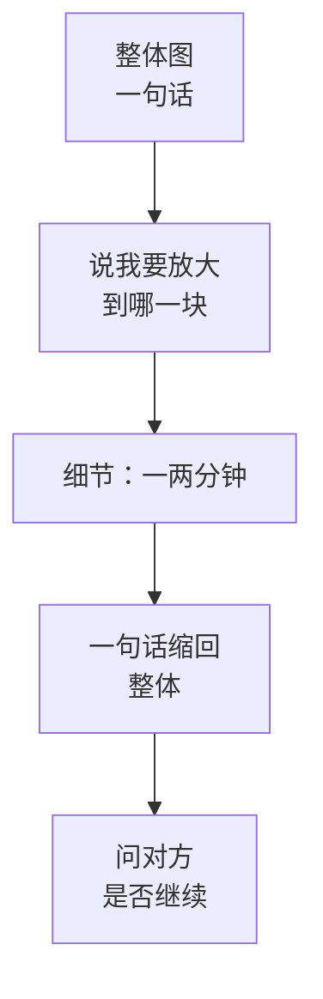

## Q
**Zoom in, zoom out · 放大与缩小**｜原则 · 追问

你在讲整体架构，面试官突然问："那这个队列的消息顺序是怎么保证的？" 你一头扎进分区细节讲了五分钟，面试官已经想不起整体图。怎么控制？

## A
**原则：** 每一层的陈述引出下一层的问题。放大（讲细节）前先**说一声**，讲完马上**缩回**整体并说明细节对整体的意义，让听的人始终知道自己在哪一层。

**怎么做：**
1. 放大前：用一句话说明，"Let me zoom in on the ordering guarantee for a minute."
2. 放大时：只讲回答这个问题所需的细节，其余推迟。
3. 缩回时：说出这个细节对整体意味着什么，"So within a partition order is guaranteed, which is all this feature needs."
4. 回到哪一层：用整体图上的位置点一下。

**常见错法：**
- **不打招呼就放大：** 听的人以为话题换了。
- **放大后不缩回：** 细节讲完，大家忘了整体。
- **在错误的层次回答：** 对方问整体，你答细节；或相反。

**出处：** Minto p. 33–40（Ch.2 The Vertical Relationship）；p. 113–136（Ch.7：Distinguish the Levels of Action）（部分）
