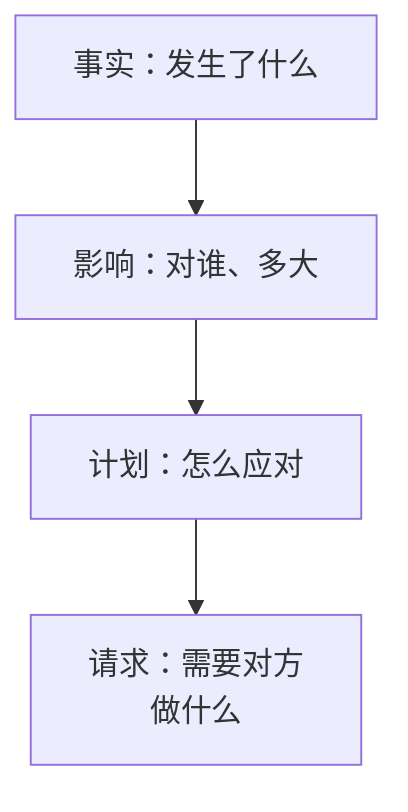

## Q
**Delivering bad news · 坏消息怎么报**｜原则 · 必会

迁移要延期一个月，你要告诉老板。你想先铺垫一番，再慢慢说。该怎么开口？

## A
**原则：** 坏消息要**早说、直接说**，按这个顺序：**事实 → 影响 → 计划 → 请求**。HBR 文章里的开场例子也是这个口气："The website crashed this morning"，直接陈述，不绕。

**怎么做：**
1. 事实：一句话，不修饰："The migration will slip by one month."
2. 影响：对交付、对客户、对成本。
3. 原因：简短，不推卸。
4. 计划：你已经做了什么、接下来做什么，可选方案。
5. 请求：需要对方决定什么或提供什么。

**常见错法：**
- **铺垫太长：** 对方一直在等"但是"。
- **只报问题不带方案：** 把工作丢给对方。
- **拖：** 越晚说，选择越少。

**改写示例：**
- Before: "So, we've been working hard and there have been some challenges, and…"
- After: "I need to flag that the migration will slip by a month. Two customers go live late. We've found the cause, and I'd like your approval to add one engineer to catch up."

出处

HBR《How to Deliver Bad News to Your Boss》（hbr.org/2022/06/how-to-deliver-bad-news-to-your-boss，页面只能读到开场摘要；顺序按通用做法推导）

