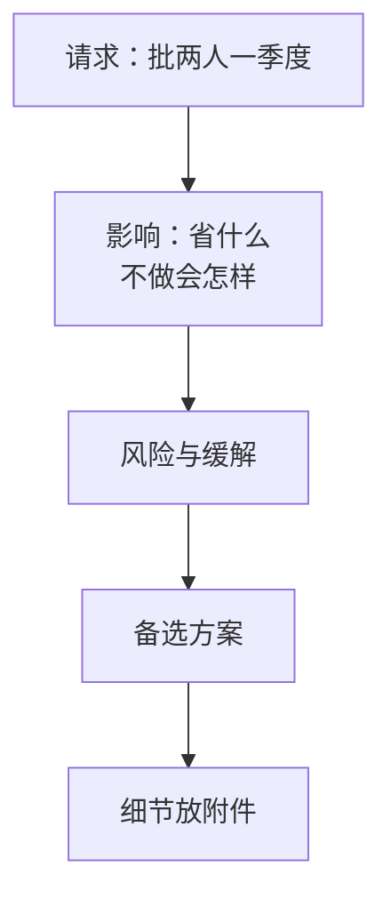

## Q
**Executives · 影响与决定**｜原则 · 必会

你要向 VP 申请两个人手、一个季度的时间，把老的计费系统迁到新平台。你有十页技术细节。VP 只给你五分钟。怎么讲？

## A
**原则：** 对管理层，先给**要他做的决定**、影响和风险，机制和细节放后面备查。他要决定的是"批不批、批多少"，不是"怎么实现"。

**怎么做：**
1. 第一句：请求加期限。"I'm asking for two engineers for one quarter to migrate billing."
2. 第二步：影响（省了什么 / 不做会怎样），用业务语言，最好带数字。
3. 第三步：主要风险和缓解办法，一页以内。
4. 说明你考虑过的备选，让他看到这是比较后的选择。
5. 技术细节放附件，被问到再展开。

**常见错法：**
- **从技术背景讲起：** 五分钟用完，请求还没说。
- **只说好处不说风险：** 一被追问就失去信任。
- **不说你要什么：** 听完他不知道自己该点头还是摇头。

**示例开头：** "I'm asking for two engineers for one quarter. Without the migration, billing outages continue; with it, we retire the old platform by Q3. The main risk is data mismatch, and we have a reconciliation plan."

出处

Minto p. 65–80（Ch.4 Fine Points of Introductions：Some Common Patterns——Giving Direction、Seeking Approval to Spend Money、Choosing Among Alternatives）

