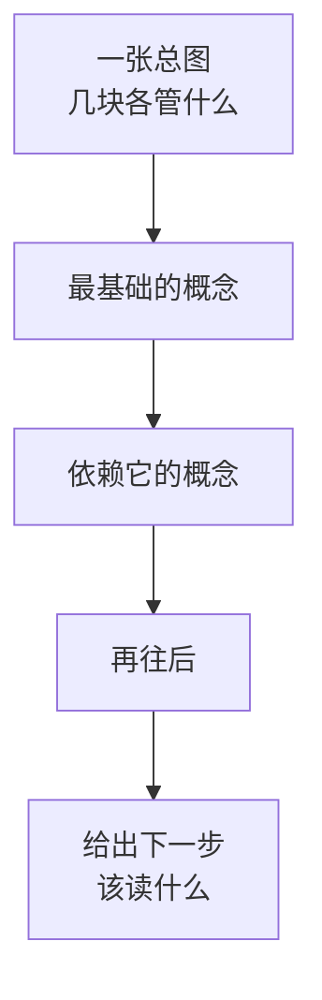

## Q
**Newcomers · 先给地图**｜原则 · 追问

新同事入职第一周，你要给他讲整个支付系统。你按系统的历史讲了一个小时，他一脸茫然。怎么讲？

## A
**原则：** 对新手先给**地图**：整体是什么、有哪几块、先学什么，再按**概念依赖的顺序**一块一块讲。每个新词出现时，它依赖的概念必须已经讲过。

**怎么做：**
1. 先说清读者要学会什么、学完能做什么。
2. 列概念依赖：A 要先懂 B，B 要先懂 C，就从 C 讲起。
3. 对比他已知的东西："It works like the old billing job, except events trigger it."
4. 新术语第一次出现就定义，术语多就给术语表。
5. 避免只在一种文化里才懂的说法。
6. 结尾给出下一步：该读什么、问谁。

**常见错法：**
- **知识的诅咒：** 专家忘了新手不知道的事。
- **按历史讲：** 历史顺序不等于理解顺序。
- **一口气讲所有例外。**

出处

Google Technical Writing One《Audience》（developers.google.com/tech-writing/one/audience：知识的诅咒、定义术语）（部分）

