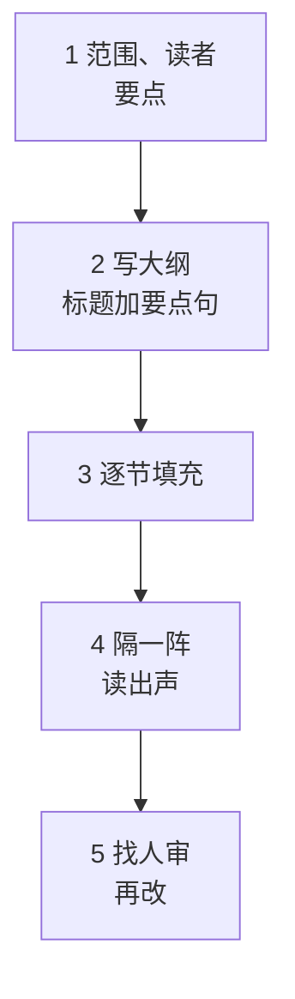

## Q
**Completing a draft · 完成初稿**｜原则 · 追问

你有一份只有几个标题和零散笔记的 design doc 草稿，deadline 在周五。你想从第一句开始一路写到底。更好的流程是什么？

## A
**原则：** 先搭**骨架**，再逐段**填充**，最后做**多轮自检**。每一轮只做一件事，别一边写一边修。

**怎么做：**
1. 先写范围、读者、关键结论（文首的一段）。
2. 大纲：每个标题下先写一句要点；这份大纲先给相关的人看一遍。
3. 逐节填充，先写难的部分；不要在这一步抠措辞。
4. 自检：读出声、隔一小时再读、换环境重读（见 Editing checklist）。
5. 找一位同行审，按反馈再改。

**常见错法：**
- **从第一句写到最后一句：** 写到一半才发现结构不对。
- **边写边改措辞：** 草稿永远写不完。
- **没留自检的时间。**

**出处：** Google Technical Writing Two《Organizing large documents》（outline 先行、先把大纲分享给相关人）、《Self-editing》（自检步骤）；流程由这两课组合而成
