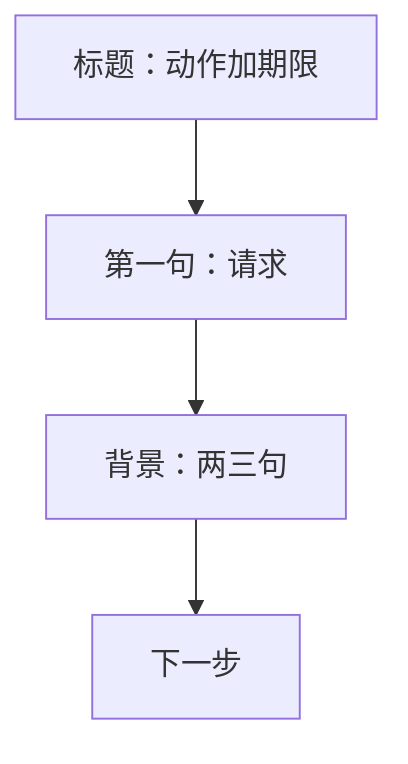

## Q
**Email & Slack messages · 消息的写法**｜原则 · 追问

你给另一个团队发了一条 Slack："Hi, quick question about the API, also the dashboard is broken, and could you review my PR?" 三天没人回。怎么改？

## A
**原则：** 一条消息让对方一眼看出**要他做什么**。标题或第一句带动作，**一条消息一个请求**，需要的背景放在请求之后。这是 Minto 的先说答案原则在邮件里的用法：读者先看到你要什么，再看为什么。

**怎么做：**
1. 标题含动作：`Request: review auth PR by Thursday` 比 `Question` 好。
2. 第一句写请求和期限："Could you review PR #482 by Thursday?"
3. 之后用两三句话给背景，必要时用 bullets。
4. 多个请求就分开发，或编号并标明优先级。
5. 末尾写下一步："I'll merge after your approval."

**常见错法：**
- **把三件事混进一条：** 对方不知道先回哪个。
- **背景在前，请求在后：** 读到最后才知道要做什么。
- **标题是"Hi"或"Question"。**

**改写示例：**
- Before: "Hi, quick question about the API, also the dashboard is broken, and could you review my PR?"
- After: "Could you review PR #482 by Thursday? It changes the auth flow for the mobile API. (Separate thread: the dashboard alert is failing, details below.)"

出处

Minto p. 57–80（Ch.4：Some Common Patterns，备忘录与邮件类开场）（部分）；具体句式由规则推导

