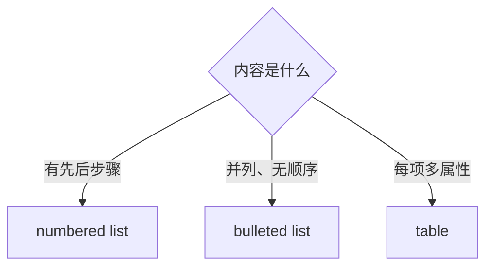

## Q
**Lists & tables · 何时用什么**｜原则 · 必会

你要写："部署服务要先构建容器，然后推到镜像仓库，最后重启集群；它支持三种语言，分别是 Go（稳定）、Java（beta）、Python（实验）。" 这段话该变成什么形式？

## A
**原则：** 顺序有意义用 **numbered list**；顺序无意义用 **bulleted list**；每项有多个属性用 **table**。一个句子里塞了并列项或步骤，就是该换成列表的信号。

**怎么做：**
1. 列表前写一句引导，结尾用冒号。
2. 各项**平行**：语法、类别、大小写、标点保持一致；以第一项为准。
3. Numbered list 每项用祈使动词开头（Open、Save、Restart）。
4. 只有完整句子才加句号。
5. Table 每列有表头；单元格尽量短，超过两句考虑换形式；一列里的数据类型一致。

**常见错法：**
- **用 run-in list 藏在句子里：** 读者找不到步骤。
- **各项不平行：** 一项是动词，一项是名词，一项是整句。
- **用 table 装长段落：** 手机上也难读。

**改写示例：**

To deploy the service:
1. Build the container.
2. Push it to the registry.
3. Restart the cluster.

| Language | Status |
|---|---|
| Go | Stable |
| Java | Beta |
| Python | Experimental |

**出处：** Google Technical Writing One《Lists and tables》（developers.google.com/tech-writing/one/lists-tables）
