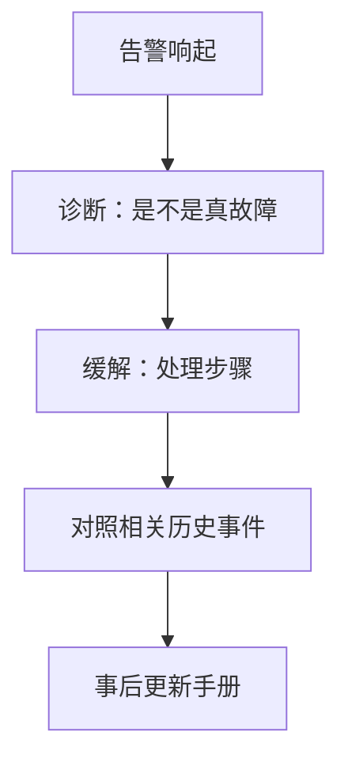

## Q
**READMEs & runbooks · 给未来的人写**｜原则 · 追问

凌晨三点告警响了，值班的新同事打开 runbook，只看到一段"系统原理"。他最需要什么？同样的问题也适用于 README。

## A
**原则：** 这两类文档都是给**在压力下查阅的人**写的：他要能很快回答"我该做什么"。**Runbook（告警手册）**：告警响时，值班工程师按它判断是不是真的出事，并一步步处理。README：新人第一次打开仓库，要知道它是什么、怎么跑起来。

**Runbook 要有：**
1. **诊断步骤：** 看哪些 dashboard、metric，怎么确定是不是真的故障。
2. **缓解办法：** 确认故障后的处理步骤。
3. **相关历史事件：** 这个告警以前是什么引起的，链接到当时的事故文档。
4. 每次事故后更新它；文档容易被排到最后，要明确留时间。

**README 要有：**
1. 一句话说明这个仓库是什么。
2. 怎么装、怎么跑、怎么测（带预期输出）。
3. 去哪儿了解更多。

**常见错法：**
- **写成设计文档：** 值班的人要的是步骤。
- **一次写完就不更新：** 过期的 runbook 比没有更糟。
- **步骤里有只有作者懂的缩写。**

**出处：** Orosz《The Software Engineer's Guidebook》ch24 §5 Oncall runbooks；ch13 §4 Documentation（部分）
