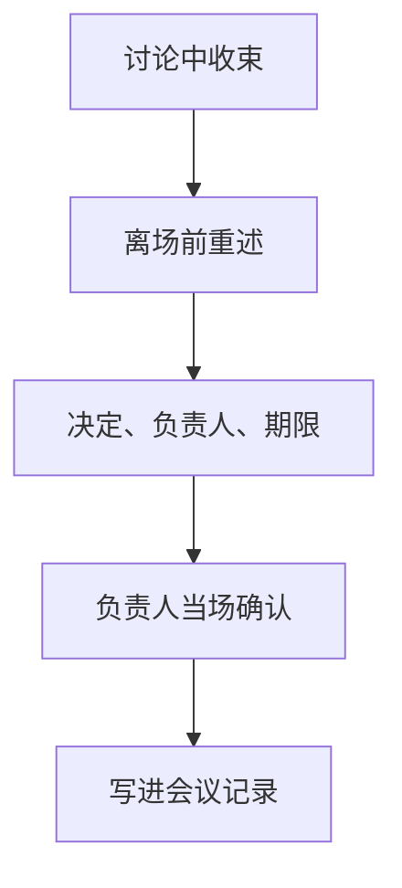

## Q
**Facilitating & summarizing · 重述决定与负责人**｜原则 · 必会

会开到最后五分钟，大家都说"差不多就这样吧"，然后各自离开。三天后没人记得谁要做什么。你作为主持人，最后五分钟该做什么？

## A
**原则：** 结束前**大声重述**：决定了什么、谁负责、什么时候。没有被说出来并确认的决定，等于没有决定。

**怎么做：**
1. 讨论中随时收束："So far we've agreed on A; the open question is B."
2. 离场前逐条重述：决定、action item、owner、期限。
3. 请负责人当场确认："Priya, you're taking the migration plan by Friday, right?"
4. 把重述的内容写进会议记录，会后尽快发出（follow-up notes：会后发给参会者的记录）。
5. 讨论跑偏，就把它停在一个"待办"里："Let's park that and come back to it after."

**常见错法：**
- **用"我们"当负责人：** "We'll look into it" 谁也不会去做。
- **只记结论不记反对意见：** 被忽略的人下次不再开口。
- **一个人说到底：** 主持人要让没发言的人也有机会说。

**改写示例：**
- Before: "OK, I think we're good. Thanks, everyone."
- After: "Let me recap. We decided to go with Redis. Priya owns the migration plan, due Friday. Marco checks the cost estimate by Wednesday. Did I miss anything?"

出处

GitLab Handbook《All-Remote Meetings》（handbook.gitlab.com/handbook/company/culture/all-remote/meetings/）；句式由规则推导，非引用

