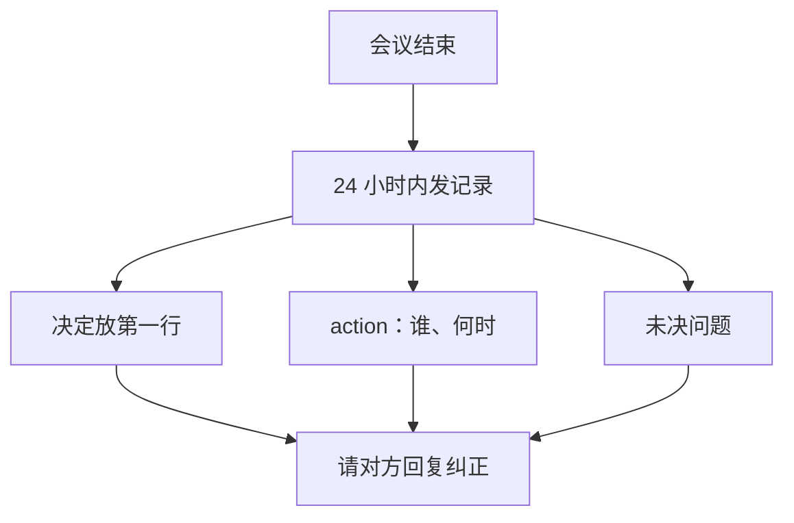

## Q
**Follow-up notes · 会后记录**｜原则 · 必会

一个小时的 design review 开完，大家都觉得"差不多定了"。你该在什么时候发什么，才能让决定真的生效？

## A
**原则：** 会后 **24 小时内**发一份短记录：决定、负责人、期限、未解决的问题。越晚发，记忆越模糊，争议越多。

**怎么做：**
1. 第一行写结论："Decision: we'll use Redis for the search cache."
2. 列 action items：谁、做什么、什么时候。
3. 列未解决的问题和下次讨论的时间。
4. 附上相关文档链接；有分歧的地方如实写出来。
5. 发给参会者和相关的人，请对方回复纠正："Please reply if I got anything wrong."

**常见错法：**
- **写成流水账：** 谁说了什么，没有结论。
- **隔几天才发。**
- **用"我们"当负责人。**

**示例：**
> Subject: Search cache review: decision and next steps
> Decision: Redis, with a 5-minute TTL.
> Priya, migration plan, Friday. Marco, cost estimate, Wednesday.
> Open: eviction policy. Revisit next Tuesday.

**出处：** GitLab Handbook《All-Remote Meetings》（handbook.gitlab.com/handbook/company/culture/all-remote/meetings/）；"24 小时内"为本卡的建议值，不是引用
