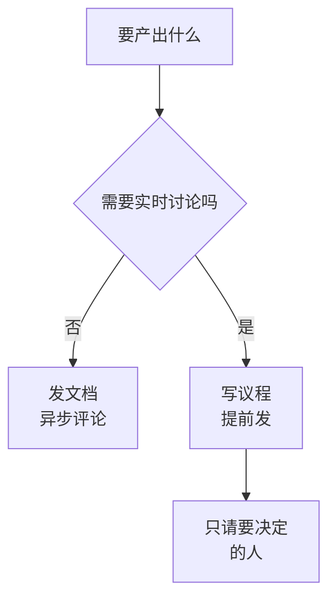

## Q
**Purpose & outcome · 目的与产出**｜原则 · 必会

经理让你组织一个"讨论一下缓存方案"的会，邀了八个人。你该先想清什么，才值得占用八个人的一小时？

## A
**原则：** 会议要先定**产出**：开完之后要有什么东西存在（一个决定、一份名单、一个负责人）。说不出产出，多半不需要开会，发一份文档即可。

**怎么做：**
1. 一句话写目的："Decide between Redis and in-process caching for the search service."
2. 会前发议程和需要先读的材料，让大家带着想法来。
3. 只邀请要做决定或提供关键信息的人，其余人看会议记录。
4. 开场第一句重复目的和要产出的东西。
5. 能异步解决的（评论文档、投票）先异步。

**常见错法：**
- **"Sync up" 式会议：** 没有目的，结果每个人听完各干各的。
- **议程会后才发：** 没有人准备。
- **请一大堆人以防万一：** 讨论变慢，责任变散。

**示例开场：** "The goal today is to pick one caching approach for search. By the end I want a decision and an owner."

**出处：** GitLab Handbook《All-Remote Meetings》（handbook.gitlab.com/handbook/company/culture/all-remote/meetings/：议程、异步优先）；具体句式由规则推导，非引用
