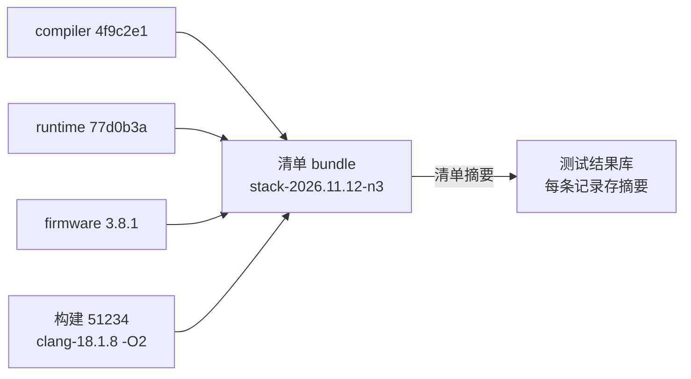

## Q
一个由编译器、运行时、固件等多个组件组成的软件栈，怎样把"测试结果"和"被测的确切版本"绑定起来？制品清单（manifest）里应该记录什么？

## A
先说组件：编译器把计算翻译成芯片程序；运行时（runtime）把程序加载到芯片执行；固件（firmware）是芯片上的底层程序。它们各自有仓库、各自出版本。

**问题**：一条测试红了，如果只知道"昨晚主干"，就说不清它测的是编译器哪个提交配哪个运行时、哪个固件。无法复现，也无法判断修复有没有进入下一个构建。

**做法：每个可测试的"组合"都有一份清单，测试结果引用清单的摘要**。

```json
{
  "bundle": "stack-2026.11.12-n3",
  "components": {
    "compiler": {"commit": "4f9c2e1", "artifact": "sha256:ab12..."},
    "runtime":  {"commit": "77d0b3a", "artifact": "sha256:cd34..."},
    "firmware": {"version": "3.8.1",  "artifact": "sha256:ef56..."}
  },
  "build": {"id": 51234, "toolchain": "clang-18.1.8", "flags": "-O2"},
  "created": "2026-11-12T03:10:00Z"
}
```



- **组件**：每个组件的提交哈希和制品摘要，不用"最新版"这种会变的引用；
- **构建信息**：构建号、工具链版本、关键编译选项；
- **清单自身的摘要**：测试结果库里每条记录存清单摘要，而不是分支名。

**带来的能力**：
- **复现**：任何一次失败都能按清单原样拼出同一个组合；
- **定位**：两个清单逐项 diff，知道两次运行之间换了哪些组件，再逐个替换定位；
- **发布追溯**：发布出去的是哪个清单，就能查到它所有的测试证据；
- **运行时自报版本**：程序启动时把各组件版本打进日志（或提供 `--version`），防止"清单说是 A，实际装的是 B"。

**常见错误**：测试环境从共享目录加载"当前"的固件，而清单记录的是另一个版本，两者不一致没人发现。对策：测试开始时读取实际加载的版本，和清单比对，不一致直接报基础设施错误。
