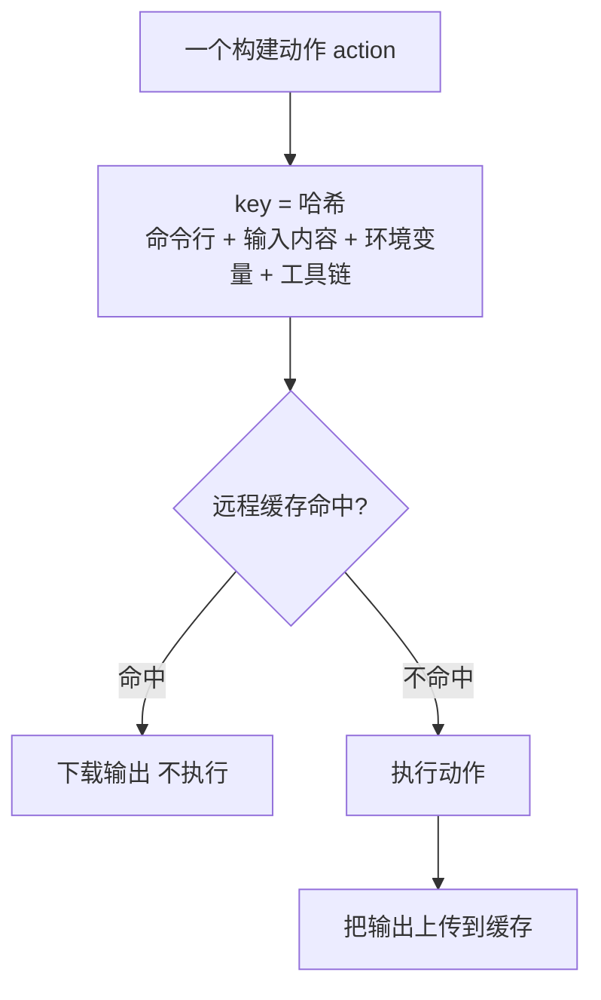

## Q
Bazel 这类构建系统的远程缓存（remote cache）是怎么工作的？为什么它连测试结果都能缓存？什么情况下缓存会给出错误的结果？

## A
**核心思想：每一步构建动作（action）是一个纯函数，相同输入一定得到相同输出，所以输出可以按输入的哈希存起来复用**。

1. **算动作的 key**：一个动作（编译一个文件、链接、跑一条测试）的 key = 哈希（命令行 + 所有输入文件的内容哈希 + 声明的环境变量 + 工具链版本）。
2. **查缓存**：远程缓存是一个按内容寻址的存储（content-addressable storage），key 命中就直接下载输出文件，不执行。
3. **不命中才执行**，执行完把输出上传。

用法：`bazel build //... --remote_cache=grpc://cache.internal:9092`；本机磁盘缓存用 `--disk_cache=~/.cache/bazel-disk`。更进一步的远程执行（remote execution）把不命中的动作直接派到构建集群上执行。

**测试结果也能缓存**：测试也是一个动作。测试程序和它的所有输入都没变，结果必然相同，Bazel 直接显示 `(cached) PASSED`，不再执行。改一行代码，只有依赖它的测试会重跑，这就是天然的测试影响分析。需要强制重跑时用 `--nocache_test_results`；依赖外部系统的测试打 `external` 标签，不缓存。

**缓存出错的情况：输入没有被完整声明**。
- 测试偷偷读了一个没声明的文件（例如 `/etc/` 下的配置、home 目录里的文件、网络上的数据），这个文件变了，key 没变，缓存仍返回旧的"通过"。
- 编译时用了构建机上某个系统库，不同构建机版本不同，缓存里混着两种产物。
- 工具链没有纳入 key：升级编译器后命中旧产物。

**防护**：开沙箱（sandbox）执行，让动作只能看到声明过的输入；工具链用构建系统自己管理的固定版本；定期在干净环境下不用缓存全量构建一次，和缓存结果对比。

所以"隔离、可复现的测试"（hermetic）不只是好习惯，它是测试结果缓存正确的前提。
