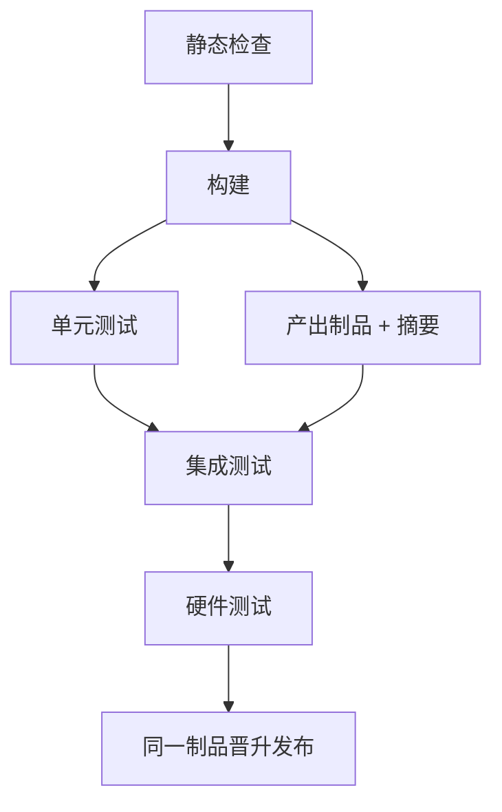

## Q
一条 CI 流水线的阶段应该怎么排？"快速反馈"和"构建一次、到处测试"（build once）分别是什么原则？

## A
**排序原则：按"单位时间发现问题的概率"排，便宜又最可能失败的放最前**。前面失败就不再浪费后面的资源。

典型顺序：
1. **静态检查**（几十秒）：格式、lint、类型检查。最便宜，失败也最常见。
2. **构建**（几分钟）：编译、打包。构建不过，后面全部没意义。
3. **单元测试**（几分钟，可并行）。
4. **产出制品**：把构建结果打包成带版本号的制品（artifact，例如 wheel 包、容器镜像、编译好的二进制），上传制品库，记录摘要（哈希）。
5. **集成测试**：从制品库拉取刚才那个制品来测，不重新构建。
6. **硬件或端到端测试**：需要稀缺资源的放最后，且只在前面都通过时才申请资源。

**构建一次、到处测试**：同一个提交只构建一次，后面所有阶段和最终发布用的都是这一份制品（按摘要引用）。如果每个阶段各自重新构建，测试通过的那份和发布出去的那份可能不同：依赖在两次构建之间更新了、构建机环境不同、编译器选项不同。

**快速反馈的其他手段**：
- **能并行就并行**：单元测试和制品打包互不依赖，同时跑；
- **失败即停**：前一阶段失败，取消后面的阶段；同一分支有新提交时取消旧的运行；
- **只跑受影响的部分**：按改动路径决定跑哪些作业；
- **先给结论**：失败的那一行和日志链接直接贴回代码评审页面。
