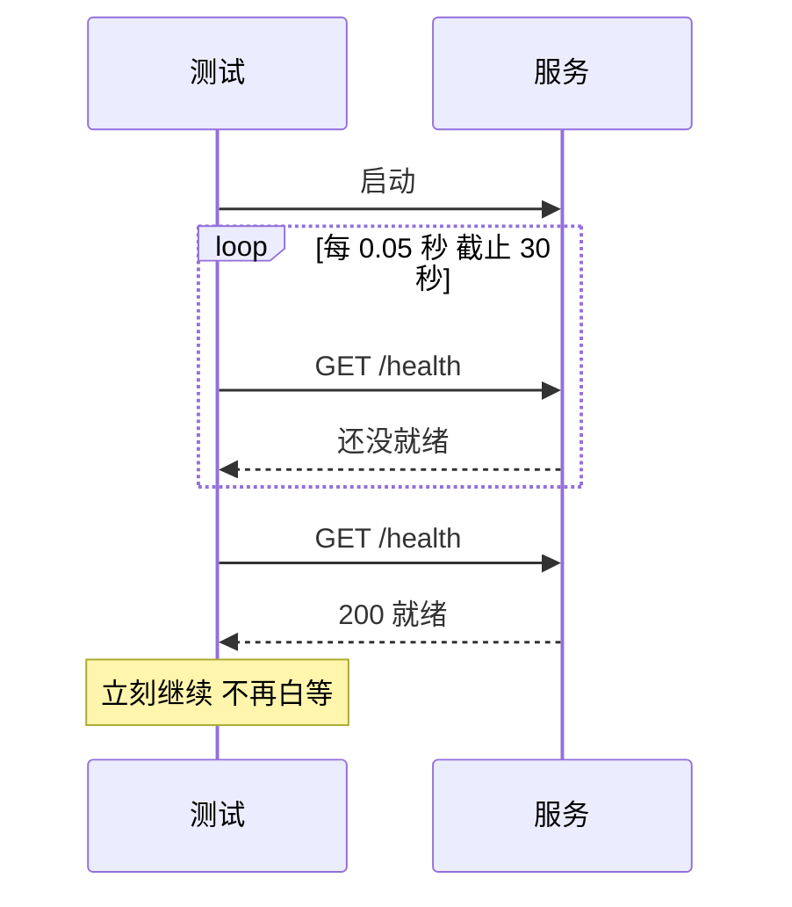

## Q
"等待写成 `sleep`"为什么是最常见的 flaky 根因？正确的等待方式是什么？

## A
**问题**：测试启动一个异步动作（起一个服务、提交一个任务），然后 `time.sleep(2)` 再检查结果。`2` 秒是作者在自己机器上试出来的：
- 在负载高的 CI 机器上，服务启动要 3 秒，测试偶尔失败；
- 有人把它改成 `sleep(10)`，失败少了，但每次都白等 10 秒，套件越来越慢，而且在更慢的机器上依然会失败。

`sleep` 的本质是**用时间猜测一个事件是否已经发生**。

**正确做法：等待条件本身，加上一个宽松的截止时间**：

```python
def wait_until(cond, timeout=30.0, interval=0.05):
    deadline = time.monotonic() + timeout
    while time.monotonic() < deadline:
        if cond():
            return
        time.sleep(interval)
    raise TimeoutError(f"条件在 {timeout}s 内未满足: {cond}")

wait_until(lambda: http_ok("http://127.0.0.1:%d/health" % port))
```



- 条件满足就立刻继续，快机器上只等几十毫秒；
- 截止时间设得远大于正常耗时（例如正常 2 秒，截止 30 秒），只在真的出问题时才失败，且失败信息说明等的是什么；
- 用 `time.monotonic()` 计时，不受系统校时影响。

**更好的做法**是让被测系统提供完成信号：就绪探针、回调、`Future`、事件队列，测试直接等待信号；或者注入假时钟，让时间推进完全由测试控制。
