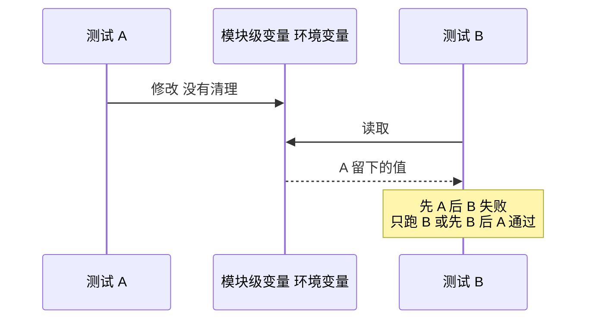

## Q
一条测试单独跑总是通过，整个套件一起跑或者并行跑（`pytest -n auto`）时偶尔失败。最可能的两类根因是什么？怎么确认、怎么修？

## A
**第一类：测试顺序依赖（test order dependency）**。某条测试留下了状态（改了模块级变量、单例、环境变量、缓存目录里的文件），另一条测试恰好依赖或被这个状态破坏。顺序一变，结果就变。

- **确认**：装 pytest-randomly，它会打乱模块、类和函数的执行顺序，并在开头打印种子。失败后用 `pytest --randomly-seed=<种子>` 精确重现同一顺序，再用 `pytest --randomly-seed=last` 重复上一次。临时恢复原顺序用 `-p no:randomly`。确认后把可疑的两条测试单独组合运行，缩小到"先 A 后 B 必失败"。
- **修**：每条测试自己建立和清理状态；用 fixture 的 `yield` 做清理；`monkeypatch.setenv` 代替直接改 `os.environ`，测试结束自动还原。

**第二类：共享资源冲突**。并行时多个测试抢同一个东西：固定端口 8080、同一个临时文件路径、同一个数据库表、同一台测试设备。
- **确认**：失败信息常是 `Address already in use`、文件被覆盖、读到别人写的数据；把并行度改成 `-n 0` 后失败消失。
- **修**：端口绑 0 让系统分配空闲端口再读出实际端口；文件用 pytest 的 `tmp_path`（每条测试一个独立目录）；数据库每条测试用独立的库或事务回滚；设备通过租约（lease）独占。

学术研究对开源项目中修复 flaky 测试的提交做过分类，排在前三的根因是异步等待（async wait）、并发和测试顺序依赖。
