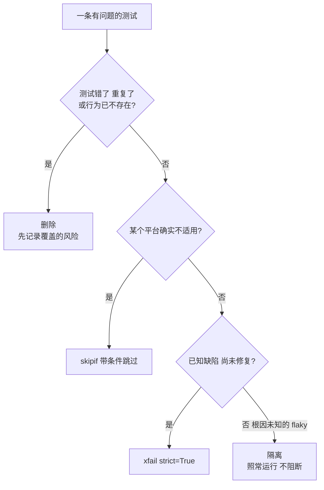

## Q
处理一条 flaky 测试，隔离（quarantine）、跳过（`skip`）、标记为预期失败（`xfail`）和删除各是什么效果？分别适合什么情况？

## A
- **隔离**：测试照常运行并记录结果，但不阻断合入或发布。保留了信号（能看到失败率变化），又不挡住别人。适合：根因未知、需要时间修复、但测试本身有价值。需要基础设施支持：结果系统能识别隔离名单。
- **跳过**：`@pytest.mark.skip(reason="...")` 让测试完全不运行。没有任何信号，问题可能永远不会被修。适合：测试在某个平台上确实不适用，用 `skipif(sys.platform == "win32")` 这种带条件的跳过；不适合用来处理 flaky。
- **预期失败**：`@pytest.mark.xfail(reason="...", strict=False)` 会运行测试，失败记为 `XFAIL`、通过记为 `XPASS`，都不让套件变红。对 flaky 测试几乎等于静音。`strict=True` 时通过反而算失败，适合"已知缺陷尚未修复"的场景，修好后会提醒你去掉标记，但不适合 flaky（它会随机通过而随机变红）。
- **删除**：适合测试本身是错的、重复的，或者覆盖的行为已经不存在。删除前记录它原本覆盖的风险，必要时用新测试替代。

按"适合"的场景选：

**错误做法**：在测试里加 `@pytest.mark.flaky(reruns=5)` 然后不管。它让失败率 20% 的测试几乎总是变绿，掩盖了可能是真实产品问题的间歇性失败。

**原则**：flaky 是缺陷，要有负责人和时限；处理方式要保留信号，并且可逆。
