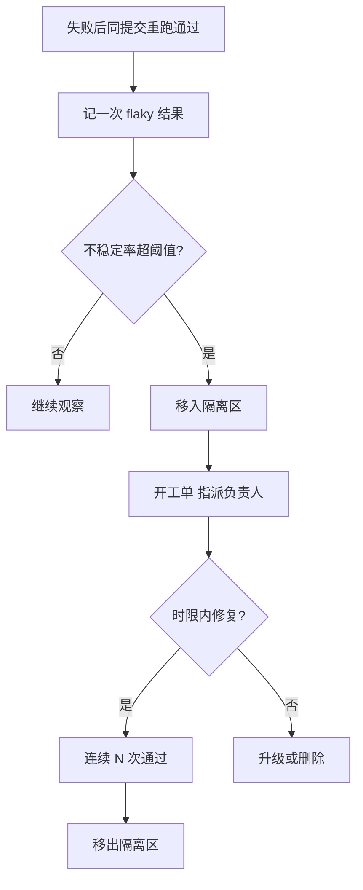

## Q
隔离区（quarantine）机制具体怎么运作？一条测试从被判定 flaky 到重新参与合入检查，要经过哪些步骤？

## A
隔离的含义：**测试照常运行、结果照常记录，但失败不再挡住合入或发布**。它不是删除，也不是跳过。

**每一步的要点**：
- **阈值**：例如 7 天内不稳定率超过 1%，或同一条测试一周内阻断了 3 次合入，就自动隔离。
- **工单与负责人**：隔离时自动创建工单，指派给测试的负责团队，附上失败日志和历史曲线。
- **时限（SLA）**：例如 P1 组件的测试 7 天内必须修复；超期升级给团队负责人。隔离区里的测试数量本身是一个健康度指标。
- **修复后验证**：在固定提交上连续跑足够多次（例如 `--count=200` 全过）再移出。
- **最终兜底**：超期且无人修复的测试，要么删除并记录它原本覆盖的风险，要么由负责人明确决定保留在隔离区。

**为什么不直接删**：被隔离的测试仍在运行，如果它开始稳定地失败（失败率从 2% 变成 100%），说明出现了真回归，仍然能被看到。
