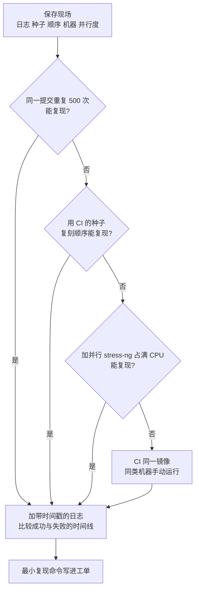

## Q
一条测试在 CI 上大约每 50 次失败一次，本地从来复现不了。怎么系统地复现它？

## A
**思路：放大失败概率，同时一次只改变一个因素。**

- **先拿到现场**：CI 上保存失败时的完整日志、随机种子、测试执行顺序、机器名、并行度和环境变量。pytest-randomly 会在开头打印种子；pytest-xdist 的输出里有每个 worker 跑了哪些测试。
- **在同一提交上大量重复**：`pytest --count=500 -x tests/test_x.py::test_case`（pytest-repeat），失败一次就停。1/50 的失败率下，跑 500 次至少失败一次的概率是 1 − 0.98⁵⁰⁰，接近 100%。
- **复刻顺序**：`pytest --randomly-seed=<CI 的种子>`，或者只运行 CI 上同一个 worker 跑过的那一组测试，检查是否是顺序依赖。
- **复刻并行和负载**：本机通常比 CI 机器快、负载低。用 `pytest -n 8` 增加并行，用 `stress-ng --cpu 8 --timeout 600s` 在后台占满 CPU，让时序问题更容易出现。
- **复刻环境**：用 CI 同一个容器镜像，在 CI 的同类机器上手动运行；对比 CI 与本地的依赖版本。
- **加日志而不是猜**：在可疑的等待点、共享状态读写处打带时间戳的日志，失败时比较成功与失败两次的时间线。

每一步只多改变一个因素：

**复现之后**：写下"最小复现命令"放进工单，例如 `stress-ng` 占满 CPU 时 `pytest --count=200 -k test_case` 可稳定复现，修复后用同一命令验证。
