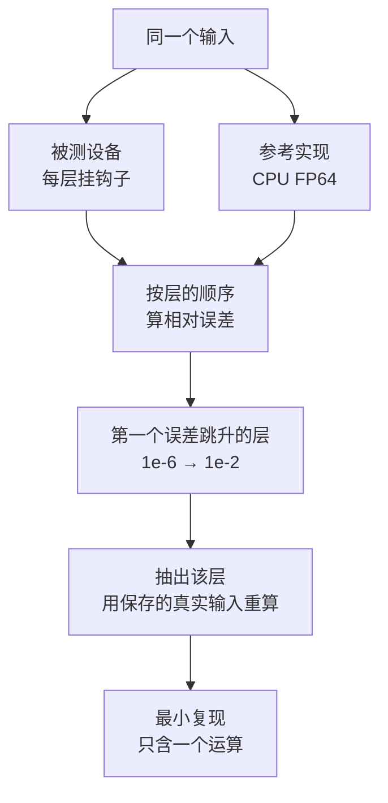

## Q
一个在加速芯片上运行的神经网络，最终输出和 CPU 上的参考实现对不上。怎样用差分测试（differential testing）找到第一处出错的地方？

## A
**先说清对象**：神经网络（neural network）可以看成一条很长的计算流水线，由几十"层"（layer）首尾相连，每层接收一个多维数组（张量，tensor），做矩阵乘、加法等计算，再把结果交给下一层。最终输出错了，错误可能在任意一层产生，然后一路传下去被放大。

**差分的做法**：同一个输入，同时在被测设备和参考实现（例如 PyTorch 在 CPU 上以 64 位浮点运行）上跑，**逐层**比较输出，而不是只比最后结果。

```python
acts = {}
def save(name):
    def hook(module, inputs, output):
        acts[name] = output.detach().to("cpu", torch.float64)
    return hook
for name, m in model.named_modules():
    m.register_forward_hook(save(name))
```

参考模型和被测模型都挂上同样的钩子（`register_forward_hook` 在每层算完后被调用），各跑一次，然后按层的顺序比较：

- 对每层算相对误差，例如 `(a - b).norm() / b.norm()`；
- 找到**第一个误差明显跳升的层**：之前各层误差都在 1e-6 量级，某一层突然到 1e-2，问题就在这一层或它的输入处理；
- 把这一层单独抽出来，用保存的真实输入在两边重算，缩小成只含一个运算（例如一次矩阵乘）的最小复现。



**注意**：误差会逐层自然累积，所以看的是"跳升"，而不是"超过某个固定值"。误差在开头几层就很大，常见原因是输入预处理或数据类型转换不一致，而不是计算本身。
