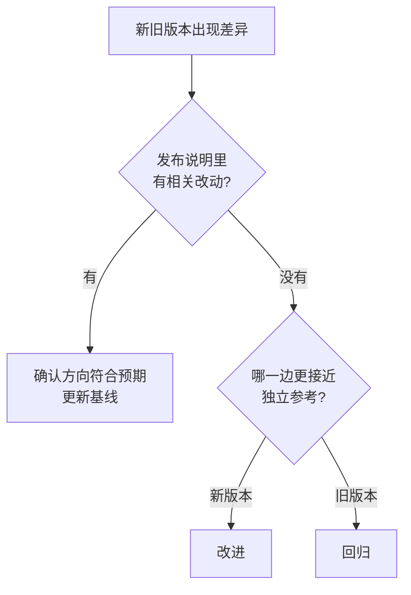

## Q
用上一个发布版本当参考实现做差分（back-to-back testing），和用独立的参考实现相比有什么优缺点？出现差异时怎么归因？

## A
**用上一版本当参考**：
- **优点**：不需要另写一个实现；任何行为变化都会被发现，适合发布回归。
- **缺点**：只能发现"变了"，不能判断"对不对"。上一版本本身的缺陷会被当作标准答案；有意的改进（修了一个旧缺陷、换了更精确的算法）也会被报成差异。

**用独立参考实现**（例如简单直观、只追求正确的 CPU 实现）：
- **优点**：能判断正确性。
- **缺点**：要写和维护；参考实现本身也可能有错；数值上和高性能实现天然有微小差异，需要容差。

**实际常两者都用**：独立参考保证正确，上一版本对比保证"没有意外变化"。

**出现差异时的归因步骤**：
1. **看差异是否预期**：本次发布说明里有没有相关改动（换了算法、改了默认参数）？有则确认差异方向符合预期，并更新基线。
2. **看哪一边更接近独立参考**：新版本更接近 → 是改进；旧版本更接近 → 是回归。

3. **看差异出现在哪里**：只在特定输入形状、特定数据类型，还是全部输入？范围越窄越容易定位到具体改动。
4. **对文本生成类输出，找第一个分歧点**：两个版本逐个比较生成的词，从第一个不同的位置开始，之后的内容都会不同，只需研究第一个分歧点。如果分歧点处两个候选词的得分几乎相等，差异多半来自正常的数值噪声；得分差距大则是真问题。
