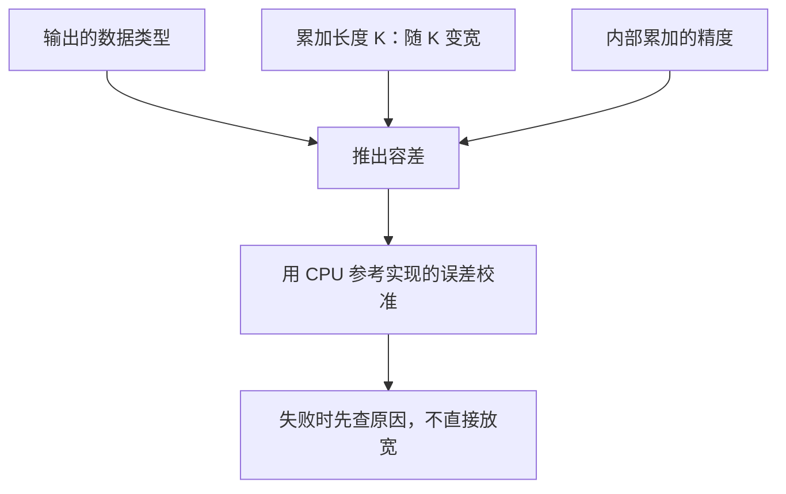

## Q
一个新的计算函数（例如在加速芯片上实现的矩阵乘法）要写正确性测试，容差应该怎么定？为什么"失败了就放宽一点"是错误做法？

## A
**从误差来源推算，再用数据校准**：

1. **看数据类型**：输出是 BF16（一种 16 位浮点格式，有效位很少，机器精度约 7.8e-3）时，单次舍入的相对误差就到千分之几，rtol 不可能定到 1e-6。
2. **看累加长度**：矩阵乘法每个输出元素是 K 个乘积之和。舍入误差随 K 增长：最坏情况大约与 K 成正比，随机舍入时更接近 √K。K = 4096 时，√K = 64，最坏 4096 倍。所以同一个函数，K 越大容差要越宽，容差应写成 K 的函数，而不是一个常数。
3. **看累加精度**：输入是 BF16 但内部用 FP32 累加，误差主要来自最后一次转回 BF16；如果内部也用 BF16 累加，误差会大得多。容差要与实现约定的累加精度对应。
4. **用参考误差校准**：在 CPU 上用同样的数据类型、同样的累加精度跑一个参考实现，与 FP64 结果比，得到合理实现的误差分布（例如 p99 相对误差 3e-3）。被测实现的容差定为这个分布的若干倍，例如 2 倍。
5. **输入要有代表性**：随机数的分布、数值范围要接近真实使用场景；全是 0 到 1 均匀分布的输入，可能掩盖大数值下的溢出。

**为什么不能"失败就放宽"**：
- 每次放宽都没有依据，几次之后容差大到真实缺陷也能通过。例如输出值在 1e-3 量级时，`atol=1e-2` 让任何结果都通过，包括全零。
- 正确做法是失败时先查原因：是容差推导错了，还是实现确实变差了。确定是推导问题时，写下新的推导再改容差。

**附加检查**：除逐元素容差外，再断言整体指标，例如相对 Frobenius 范数误差 `‖a − b‖ / ‖b‖ < 1e-2`，以及"超出容差的元素比例为 0"。
