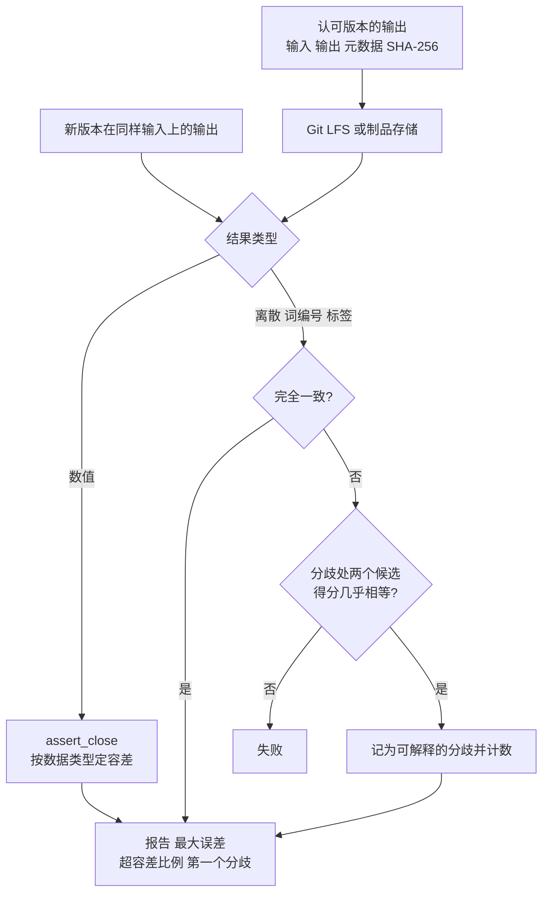

## Q
给一个数值计算服务（例如每个发布都要验证的模型推理输出）建立黄金文件（golden file），应该存什么、怎么比较？和文本快照有什么不同？

## A
**先说清对象**：模型推理（inference）就是把一组固定的数字（训练得到的参数）和输入一起算出输出。同样的输入，每个版本都应给出几乎相同的输出，所以可以把一个"认可的版本"的输出存下来，作为后续版本的标准答案。

**存什么**：
- **输入**：固定的一组输入及其编号，覆盖典型情况和边界情况；
- **输出**：数值结果本身（数组），对文本生成类服务还要存逐步选出的词编号；数据大时只存最关键的部分，例如每一步得分最高的前 5 个候选及其分数；
- **元数据**：生成黄金文件的软件版本、硬件、数据类型、随机种子、生成命令和时间；
- **校验和**：文件的 SHA-256，防止被意外修改。

**怎么比较**：
- **数值用容差**：`torch.testing.assert_close(actual, golden, rtol=..., atol=...)`，容差按数据类型确定。逐字节比较只适合确定性 CPU 计算，在并行硬件上会随机失败。
- **离散结果用精确比较**：选出的词编号、分类标签必须完全一致；若不一致，检查分歧处两个候选的得分是否几乎相等，几乎相等则记为"可解释的分歧"并计数。
- **报告汇总**：最大误差、超出容差的元素比例、第一个分歧位置。

**和文本快照的不同**：文本快照逐字比较，评审者能读懂差异；数值黄金文件的差异人眼无法判断，必须配汇总统计和明确的容差。存储上，大数组不直接放进代码仓库，用 Git LFS 或制品存储，仓库里只保留路径和校验和。
