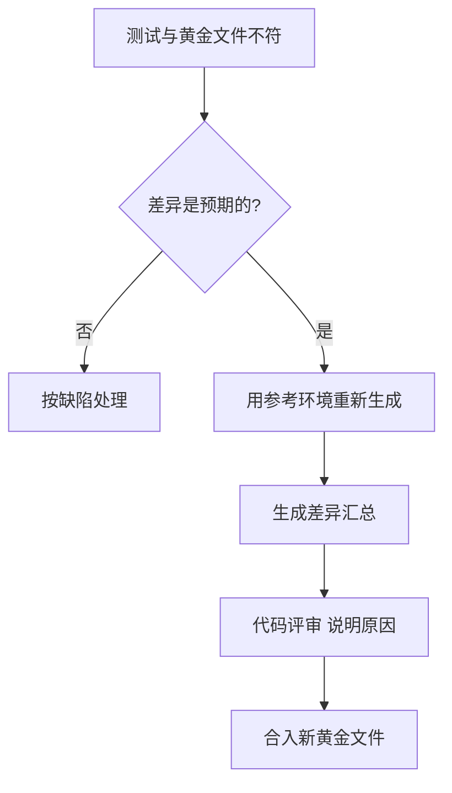

## Q
黄金文件需要更新时，正确的流程是什么？什么是黄金文件漂移（golden drift），怎么防止？

## A
**更新流程**：

- **只在有意的行为变化时更新**：例如换了更精确的算法，发布说明里写明了。
- **用参考环境生成，而不是被测的构建**：如果直接用"当前构建的输出"覆盖黄金文件，缺陷会被写成标准答案。
- **显式命令**：例如 `pytest --update-golden`（自定义选项），默认运行永远只比较不写入。
- **差异汇总进评审**：改了多少条、最大误差多少、哪些离散结果变了，评审者签字。
- **单独提交**：黄金文件更新和代码改动分开，便于回看和回滚。

**漂移**：每次更新都只差一点，各自看起来都"在容差内、可以接受"，但几十次更新累计起来，黄金文件已经离最初的正确结果很远。例如每个版本精度损失 0.1%，二十个版本后就是约 2%，没有任何一次评审会拦下它。

**防止漂移**：
- **保留一个固定锚点**：一份不随版本更新的、由独立参考实现（例如 FP64 计算）生成的结果，每次发布都和它比较，误差上限不变。
- **记录趋势**：把每个版本相对锚点的误差画成曲线，持续上升就要追查。
- **限制一键全量更新**：一次改动更新大量黄金文件时，要求额外评审。
