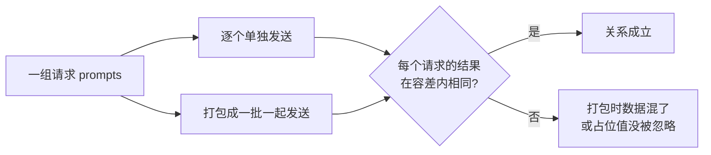

## Q
什么是蜕变测试（metamorphic testing）？给出几个用在推理服务或搜索服务上的蜕变关系，以及用 Hypothesis 实现的方式。

## A
**问题**：很多系统没有现成的"标准答案"（测试判定难写），但我们知道**输入怎样变化时，输出应该怎样变化**。这种关系叫蜕变关系（metamorphic relation）。测试不检查单个输出对不对，而检查一对输出之间的关系是否成立。

**例子**：
- **排序服务**：输入列表打乱顺序，排序结果不变；
- **搜索服务**：在搜索结果之外加一篇完全无关的文档，原有结果的相对顺序不变；
- **批量处理不变性**：推理服务（把训练好的模型部署成接口，收到输入就算出结果）会把多个请求打包成一批（batch）一起计算。同一个请求单独发送，和与其他 31 个请求一起发送，结果应当相同（在数值容差内）；
- **填充不变性**：为了让一批数据长度对齐，会在短输入后面补上无意义的占位值（padding）。补多少占位值都不应该改变真实部分的结果；
- **缓存不变性**：开启和关闭"复用之前算过的中间结果"的缓存，输出应当相同。

以批量处理不变性为例，测试比的是两次运行之间的关系：



**用 Hypothesis 自动生成输入**：

```python
from hypothesis import given, strategies as st

@given(st.lists(st.text(min_size=1, max_size=50), min_size=1, max_size=8))
def test_batch_invariance(prompts):
    alone = [server.run([p])[0] for p in prompts]
    batched = server.run(prompts)
    for a, b in zip(alone, batched):
        torch.testing.assert_close(b, a, rtol=1e-3, atol=1e-5)
```

Hypothesis 随机生成输入，失败时自动缩小到最小反例（例如两个长度不同的短字符串）。

**价值**：蜕变关系常常能抓到普通用例抓不到的缺陷，例如打包时把不同请求的数据混在一起、占位值没有被正确忽略。
