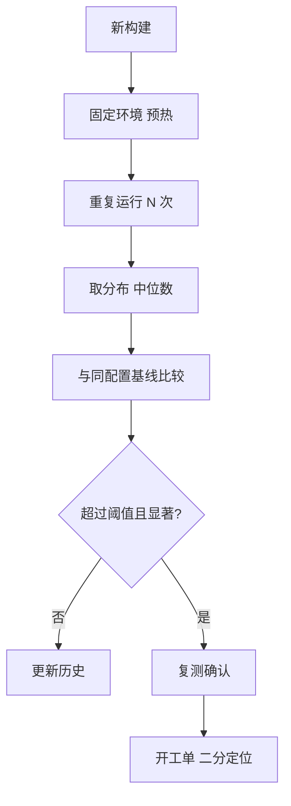

## Q
自动化的性能回归检测流程是怎样的？为什么基线必须按配置分别维护？

## A
**流程**：

- **固定环境**：同型号硬件、同驱动和固件版本、关闭频率波动来源，每次运行前做预热。
- **重复运行**：每个基准至少跑 5–10 次，得到分布而不是一个数；对同一构建的多次运行，差异就是噪声的大小。
- **比较统计量**：比较中位数或分布（对离群值稳健），不比较单次最快或平均值。
- **阈值 + 显著性**：变化同时满足"大于最小有意义变化（例如 3%）"和"统计上显著"才判为回归。
- **复测确认**：检测到回归后在同一构建上再跑一轮，排除偶然的环境问题。
- **定位**：在上一个正常构建和当前构建之间二分。

**为什么按配置维护基线**：性能是"代码 × 配置"的函数。同一个推理服务（把训练好的模型部署成接口的服务），在不同硬件、不同的数据精度（例如 16 位和 8 位数字格式）、不同的批量大小（一次打包一起计算的请求数）、不同的输入长度下，数字可以差几倍，噪声大小也不同。把所有配置混在一个基线里：
- 一个配置变慢 10%，可能被另一个配置变快抵消；
- 不同配置的噪声不同，统一阈值要么在噪声大的配置上频繁误报，要么在噪声小的配置上漏报。

所以基线的键是"基准名 + 硬件 + 精度 + 批量 + 输入规模"等，每个键有自己的历史和阈值。
