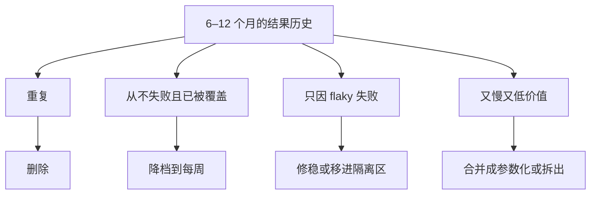

## Q
发布回归套件越长越慢，从 2 小时涨到 12 小时。怎么识别并修剪低价值的用例？

## A
**先收集每条测试的历史数据**（来自结果库，例如过去 6–12 个月的 JUnit XML 汇总）：运行时间、失败次数、失败中真实缺陷的比例、和其他测试同时失败的情况、覆盖到的代码。

**四类候选**：
- **重复**：两条测试覆盖几乎相同的代码路径，且每次失败都同时失败。保留失败信息更清楚的那条。
- **从不失败且覆盖已被别处覆盖**：一年没失败过不一定没价值（可能守着关键行为），但如果它覆盖的代码行全部被其他测试执行过、断言也重复，就是修剪候选。
- **只因 flaky 失败**：所有失败都被判定为 flaky、从没抓到过真实缺陷，先修稳；修不稳就移出发布套件放进隔离区。
- **又慢又低价值**：按"运行时间 ÷ 抓到的真实缺陷数"排序，排在最前面的优先处理。

**处理方式不只有删除**：
- **降档**：从发布验证降到每周运行；
- **合并**：多条只差参数的测试改成一条参数化测试，共享昂贵的准备步骤（例如只启动一次服务）；
- **缩小规模**：把 2 小时的长稳从发布套件移出，单独作为长稳任务。

**护栏**：每次修剪都要评审并记录理由；修剪后的前几个发布保留被移除测试的低频运行，确认没有漏掉回归。
