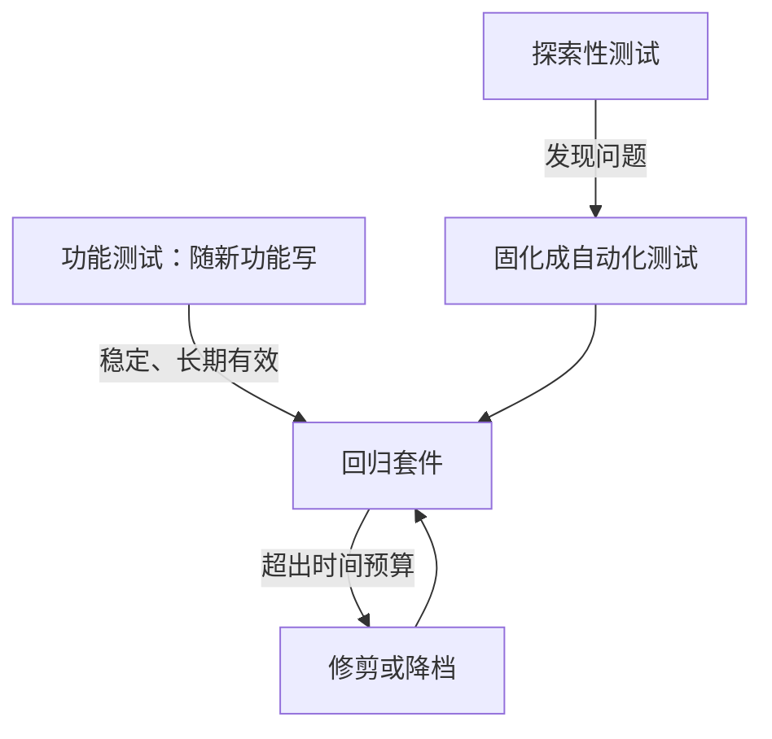

## Q
回归套件和功能测试套件、探索性测试有什么区别？回归套件"只增不减"会带来什么代价？

## A
**三者的分工**：
- **功能测试套件**：随新功能开发而写，验证新行为符合需求，变化快，可以有较多与实现相关的断言。
- **回归套件**：守护**已经发布、已经承诺**的行为，目的是保证改动不破坏它们。要求稳定、长期有效、失败含义明确。
- **探索性测试（exploratory testing）**：人带着目标去尝试、观察和提问，发现事先没想到的问题；发现的问题再固化成自动化回归测试。

**只增不减的代价**：
- **时间**：每个版本加几十条，几年后发布套件从 2 小时涨到十几小时，只能每周跑一次，反馈变慢。
- **噪声**：测试越多，flaky 越多，一次全绿越难，大家开始接受"红几条是正常的"，真正的回归淹没在噪声里。
- **维护**：每次合理的行为改动都要改一堆过时的测试，开发者把测试当成负担。
- **虚假的覆盖感**：条数很多，但很多测的是同一条路径。

**做法**：把套件当作需要维护的产品。设运行时间预算（例如发布验证不超过 8 小时），超预算就必须修剪或降档才能加新测试；每个季度用失败历史和覆盖数据审查一次。
