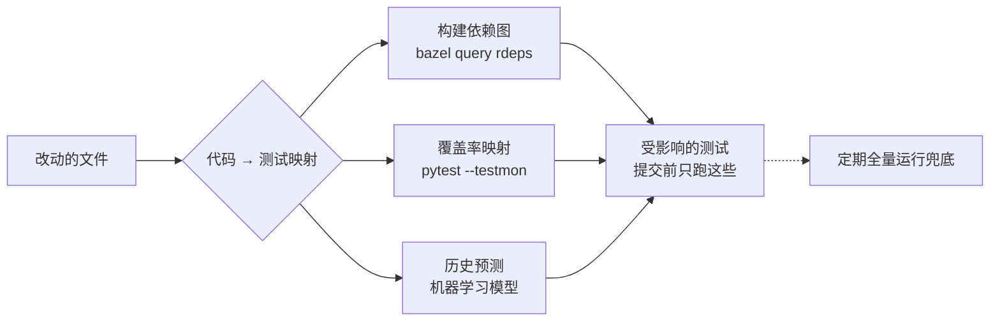

## Q
测试选择（test selection）或测试影响分析（test impact analysis）是怎么工作的？给出几种常见实现。

## A
目标：**一个改动只跑可能受它影响的测试**，而不是全部。核心是建立"代码 → 测试"的映射，再用改动的文件去查。

**三种建映射的方法**：
- **构建依赖图**：Bazel 这类构建系统知道每个目标依赖谁。改了一个库，就找出所有直接或间接依赖它的测试目标：`bazel query 'kind(".*_test", rdeps(//..., //lib/batching:batching))'`。优点是精确到构建图、确定性强；缺点是只看得到声明过的依赖，读配置文件、动态加载的依赖看不到。
- **覆盖率映射**：先跑一遍全量测试并记录每条测试执行了哪些代码，之后按改动的行查找受影响测试。Python 的 pytest-testmon（`pytest --testmon`）就是这样：第一次全量运行建立数据库，之后只跑受改动影响的测试。缺点是映射会过时，且数据文件、配置变化不在代码覆盖里。
- **基于历史的预测**：用机器学习模型根据改动特征（改了哪些文件、谁改的）和历史结果预测哪些测试可能失败。Facebook 2019 年发表的预测性测试选择（predictive test selection）在生产中把测试基础设施成本降为一半，同时仍报告超过 95% 的单条测试失败和超过 99.9% 的有问题的改动。

**JavaScript 世界的轻量版本**：Jest 的 `--onlyChanged`、`--changedSince=main`；Nx 的 `nx affected -t test`。

**共同点**：都只是缩小提交前的范围，必须配合定期全量运行兜底。
