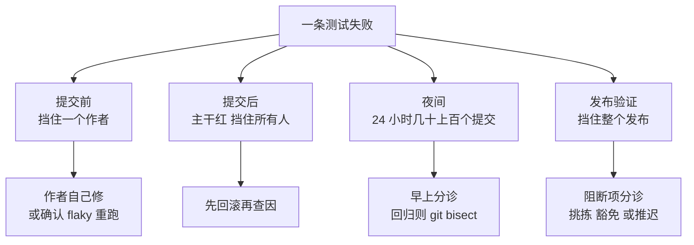

## Q
同样是一条测试失败，出现在提交前、提交后、夜间和发布验证这四档时，处理方式有什么不同？

## A
处理方式由两件事决定：**失败挡住了谁**、**候选变更有多少个**。

- **提交前失败**：只挡住这一个改动的作者。候选变更就是这一个改动，作者自己修，或者确认是 flaky 后重跑并报告。主干不受影响。
- **提交后失败**：主干已经红了，所有人都受影响。候选是最近几个提交，处理规则是**先回滚再查因**（revert first）：值班的构建负责人（build cop / sheriff）找到嫌疑提交直接回滚，作者修好再重新合入。目标是主干红灯持续时间以小时甚至分钟计。
- **夜间失败**：候选是过去 24 小时的几十到上百个提交。第二天早上分诊：先判断是产品回归、flaky、环境问题还是测试本身的缺陷；回归则对一天的提交区间做二分（`git bisect run <测试脚本>`，对 128 个提交最多约 7 次）。
- **发布验证失败**：挡住的是整个发布。失败进入阻断项分诊（blocker triage）：评估严重度，决定修复后挑拣（cherry-pick）进发布分支、豁免（waiver）并记录为已知问题，或推迟发布。修复后要在发布分支上重跑相关套件。

**为什么要分开处理**：同样的"直接回滚"，在提交前没有意义，在发布验证里可能来不及；同样的"等明早再看"，在提交后会让主干红一整夜，挡住所有人。
