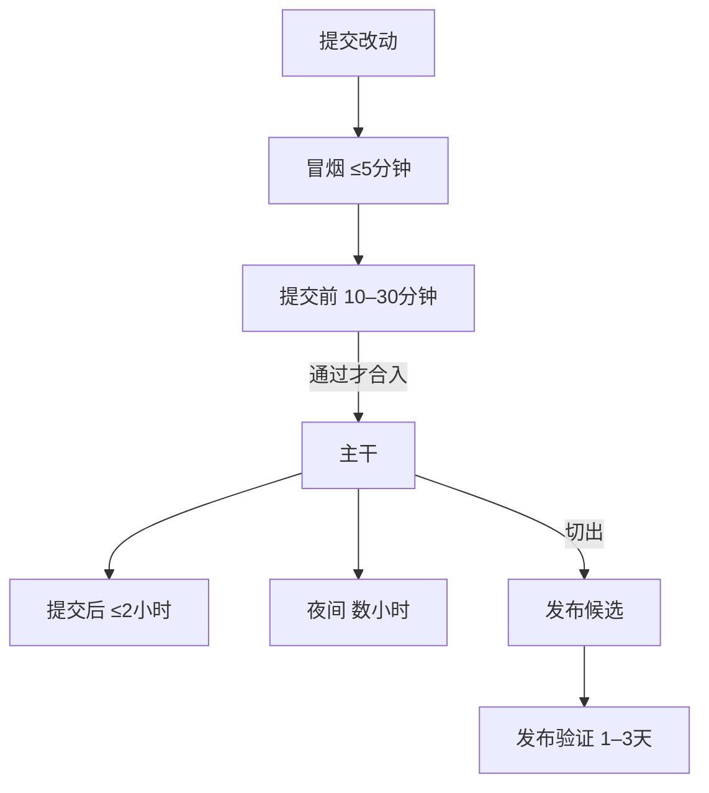

## Q
回归测试通常分成冒烟（smoke）、提交前（presubmit）、提交后（postsubmit）、夜间（nightly）和发布验证（release qualification）五档。每档的目的和时间预算大约是多少？

## A
分档的原则：**越早运行的档越快、越稳定，越晚的档越全、越贵**。下面是常见的量级，具体数字各团队不同：

- **冒烟**：几分钟（通常 ≤ 5 分钟）。只回答"这个构建能不能用"：能启动、主路径一条请求能通。任何更重的测试之前先跑它，不通就不浪费后面的资源。
- **提交前**：10–30 分钟。每个改动合入主干前必须通过，覆盖改动相关模块的单元和快速集成测试。目标是挡住大部分明显回归，又不让开发者等太久。
- **提交后**：30 分钟到 1–2 小时。合入后对主干的每个提交或每几个提交跑，包含较慢的集成测试和小规模硬件测试。失败时候选范围是最近几个提交。
- **夜间**：几小时。每天对主干跑一次全集：全部组合、长测试、性能基准、短时长稳。失败时候选范围是一天内的所有提交。
- **发布验证**：一到几天。只对发布候选（release candidate，准备发布的那个版本）跑：完整回归、多小时长稳、故障注入、性能与正确性门限，结果直接决定能否发布。

Bazel 用测试尺寸表达同样的分层：small、medium、large、enormous 的默认超时分别是 60、300、900、3600 秒。
